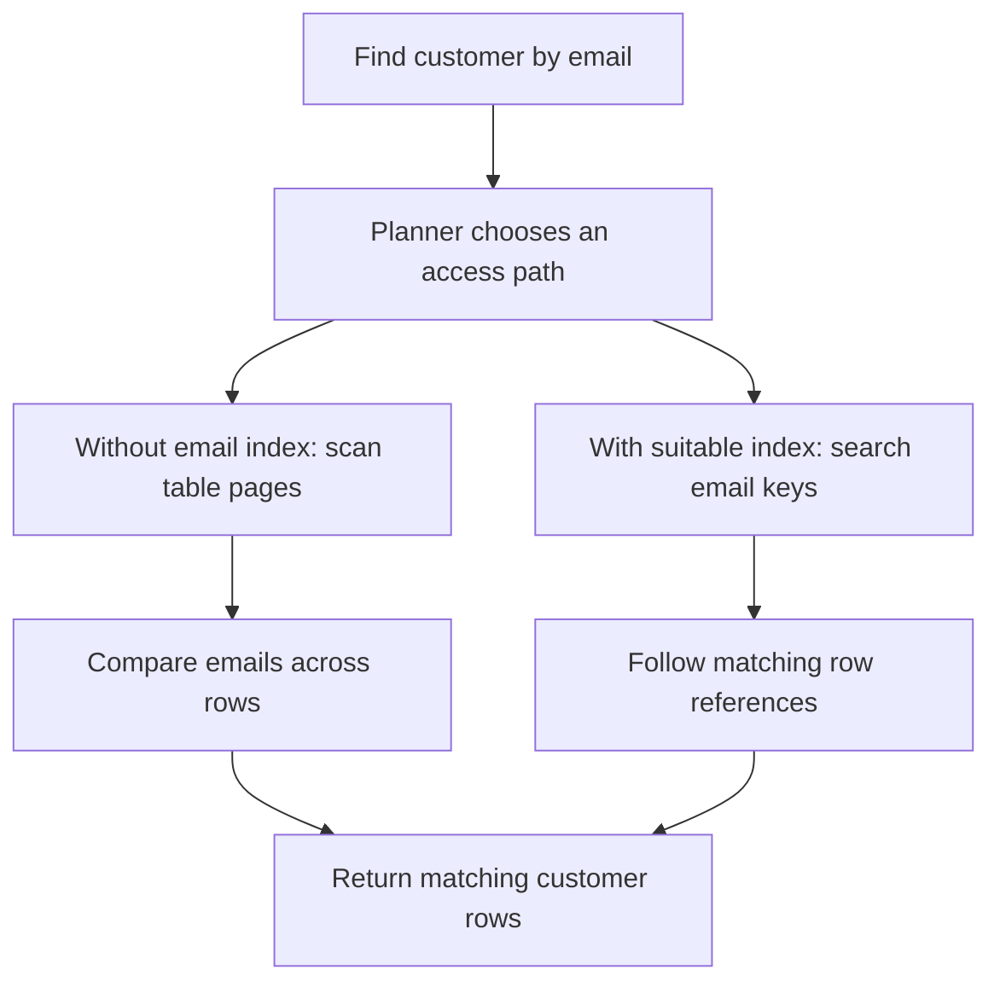

# Phase 1 — Concept 1: What is a database index?

## 1. Start with a real backend problem

Imagine your application has one million customers. Someone logs in with an email address. Your backend must find that customer's record:

```sql
SELECT id, full_name, email, city
FROM index_lab.customers
WHERE email = 'customer987654@example.com';
```

A **table** stores records. A **row** is one record. A **column** is one field, such as email. A **query** is an instruction asking the database for data.

Here is a small illustration of the table; the lab actually creates one million rows:

| id | full_name | email | city |
|---:|---|---|---|
| 1 | Customer 1 | customer1@example.com | Bangalore |
| 2 | Customer 2 | customer2@example.com | Hyderabad |
| 3 | Customer 3 | customer3@example.com | Chennai |
| 987654 | Customer 987654 | customer987654@example.com | Pune |
| 1000000 | Customer 1000000 | customer1000000@example.com | Delhi |

Without a suitable email index, PostgreSQL can read through the table and compare each email with the requested value. This is a **sequential scan**. It processes table pages, not one separate physical disk operation for every row. Pages may already be in memory.

There is no LIMIT in this query. PostgreSQL cannot stop at the first match because another row could have the same email. Our normal email index will not impose uniqueness either.

## 2. The definition

A **database index is an additional data structure that helps the database locate rows using values from one or more columns**.

Think about the index at the back of a textbook. To find “transactions,” you look up that word and follow its page references. You do not read the entire textbook. The database has a similar problem: locate relevant records without examining every record.

For this lesson, we create PostgreSQL's default B-tree index:

```sql
CREATE INDEX idx_customers_email
ON index_lab.customers (email);
```

Read it piece by piece:

- `CREATE INDEX`: build a new index.
- `idx_customers_email`: the name we choose for it.
- `ON index_lab.customers`: the table receiving the index, inside our lab schema.
- `(email)`: the column whose values are indexed.

You continue writing the same SELECT query. PostgreSQL's **planner**, the part that chooses how to execute a query, decides whether to use the index.

## 3. Table and index are separate structures

The table retains the complete customer records. The email index contains searchable email keys and references to table row versions. It is not another full copy of every customer column.

Conceptual illustration only:

| Searchable email key | Reference to a table row |
|---|---|
| customer1@example.com | location of Customer 1 |
| customer10@example.com | location of Customer 10 |
| customer100@example.com | location of Customer 100 |
| customer2@example.com | location of Customer 2 |

Text keys are ordered as text under the applicable collation, not by the numeric customer suffix. Exact physical index layout is more complex than this illustration.



In PostgreSQL an ordinary index scan fetches the requested full_name and city from the table after finding matching entries in the email index. A later lesson covers index-only scans.

**Creating an index does not physically reorder the table. An index also does not promise SQL result order: use ORDER BY when order matters.**

## 4. Does the primary key already give us an index?

Our table declares `id bigint PRIMARY KEY`. PostgreSQL automatically creates an index to enforce that primary key. It helps with `WHERE id = 987654`.

It does not provide an email-key lookup for `WHERE email = '...'`. Indexes are associated with particular columns or expressions. Having one index does not make every query fast.

## 5. What does an index cost?

An index takes additional storage. Building it takes work. Later inserts and relevant updates must maintain its entries. Deletes leave cleanup work under PostgreSQL's row-versioning system.

A normal index improves access; a unique constraint expresses a rule that duplicate values must not be allowed. `CREATE INDEX ... (email)` does **not** enforce unique emails. Our final script demonstrates this inside a transaction that is rolled back.

An index is useful when its access path costs less than alternatives. If a query needs most of the table, a sequential scan can still be better. Do not force index scans just to claim a faster result.

## 6. Run the one-million-row Docker lab

### Requirements

Install and start Docker Desktop on Windows, or Docker Engine with Compose v2 on Linux. Confirm `docker version` and `docker compose version` work. Allow room for the PostgreSQL image, data, index, and write-ahead log; several gigabytes of free disk space is sensible. The first download and data load can take time.

From your existing repository checkout:

```powershell
git pull origin main
cd database-indexes/phase-01/01-what-is-an-index
docker compose up -d --wait
docker compose exec -T db psql -U index_student -d index_lab -v ON_ERROR_STOP=1 -f /lab/run-all.sql
```

The same commands work in Bash. If you have no checkout yet, first run:

```powershell
git clone https://github.com/Nithnreddy-nithi/lld-learning.git
cd lld-learning
```

`run-all.sql` recreates **only the index_lab schema**, inserts exactly 1,000,000 rows, checks the count, runs the before/after comparison, prints sizes, and demonstrates row references and duplicate emails. Rerunning it deletes prior work inside that lab schema.

The PostgreSQL service uses version 18, a named volume for persistence, and a read-only mount of the SQL directory. No automatic initialization hook is used: you explicitly run the scripts, so existing volumes do not silently skip data loading.

The optional host connection is `localhost:55432`, database `index_lab`, user `index_student`, password `local_lab_only`. This password is for this local learning container. If port 55432 is occupied, change the left-hand port in compose.yaml or remove the ports entry; docker compose exec still works.

### Run each step separately for learning

```powershell
# 1. Create the table and insert one million rows.
docker compose exec -T db psql -U index_student -d index_lab -f /lab/01-setup.sql

# 2. Run the email search without an email index.
docker compose exec -T db psql -U index_student -d index_lab -f /lab/02-before-index.sql

# 3. Build the email index and repeat the SAME search.
docker compose exec -T db psql -U index_student -d index_lab -f /lab/03-after-index.sql

# 4. Examine row locations and demonstrate duplicate emails.
docker compose exec -T db psql -U index_student -d index_lab -f /lab/04-table-and-index.sql
```

You can run step 2 again: it removes just the email index. Step 3 recreates it. Run the steps in order the first time.

## 7. How the million rows are generated

Read sql/01-setup.sql alongside this explanation.

- `generate_series(1, 1000000)` produces numbers 1 through 1,000,000 inside PostgreSQL.
- Each number becomes an id, a customer name, and an email.
- `||` joins text pieces: `'customer' || 5 || '@example.com'` produces `customer5@example.com`.
- `%` is remainder after division. We use it to cycle through five cities and 365 dates.
- `repeat(...)` adds profile text so the table is more realistic than an id-only dataset.
- `INSERT ... SELECT` inserts all generated records without a Python loop or a million network requests.
- `ANALYZE` collects statistics that help the planner estimate query costs.

The data is deterministic: Customer 987654 always exists, and its email matches exactly once after setup. The assertion block raises an error if the million-row count or target count is wrong.

## 8. Read the before/after plans

`EXPLAIN` describes the execution plan. `ANALYZE` inside EXPLAIN actually executes the query and measures it. `BUFFERS` reports database buffer activity. This is different from the standalone ANALYZE command that collects statistics.

Expected shape, not a recorded benchmark:

```text
Before:
Seq Scan on customers
  Filter: (email = 'customer987654@example.com'::text)
  Rows Removed by Filter: 999999

After:
Index Scan using idx_customers_email on customers
  Index Cond: (email = 'customer987654@example.com'::text)
```

These abbreviated examples intentionally omit invented timing values. Your actual output includes estimates, actual rows, buffer counts, planning time, and execution time. PostgreSQL may choose a different plan depending on settings and data.

The scripts turn off parallel workers only for these sessions to make the scan easier to read. Otherwise you might see a parallel sequential scan with per-worker row counts. They do not disable sequential scans or force index usage.

| Observation | Before email index | After email index |
|---|---|---|
| Matching customer | Same row | Same row |
| Likely access path | Sequential scan | Email index scan |
| Search work | Check emails across the table | Find matching key and fetch row |
| Extra email-index storage | None | Present |
| Future writes | Maintain primary-key index | Maintain primary-key and email indexes |

Focus on the change in access path and buffer work, then compare timings. Each script repeats the measured query because later runs may use cached pages. Index creation also reads the table, affecting caches. This is an educational comparison, not a controlled cold-disk benchmark. A shared buffer read can still be served by the operating system cache; it does not prove a physical disk read occurred.

Record your own observations:

| Run | Plan | Execution time | Shared hits | Shared reads |
|---|---|---|---|---|
| Before 1 | | | | |
| Before 2 | | | | |
| After 1 | | | | |
| After 2 | | | | |

Do not compare the CREATE INDEX build time to SELECT execution time. They measure different operations.

## 9. Inspect the working table yourself

Open an interactive SQL session:

```powershell
docker compose exec db psql -U index_student -d index_lab
```

Then run:

```sql
SET search_path TO index_lab, public;
SELECT count(*) FROM customers;
SELECT id, full_name, email, city FROM customers ORDER BY id LIMIT 10;
SELECT * FROM customers WHERE email = 'customer987654@example.com';
\d customers
\di index_lab.*
```

`\d` describes the table; `\di` lists indexes. `\q` exits psql. One million rows are stored in the database; you should inspect a small result rather than print the entire table.

The final script also selects `ctid`, PostgreSQL's current physical row-version location, shown as `(block number, position within block)`. This helps illustrate what a row location means. It is not a stable application identifier, and it can change on updates or table rewrites. Keep using id in application code. The ctid SELECT is a projection from the table, not a raw dump of B-tree pages.

## 10. Stop, restart, and reset

```powershell
# Stop containers; keep database data.
docker compose down

# Restart with the same saved data.
docker compose up -d --wait
```

For a full reset, `docker compose down -v` deletes this Compose project's database volume. Run it only when you want to discard the lab database. You can usually just rerun setup instead.

If startup fails, inspect `docker compose ps` and `docker compose logs db`. A connection error often means startup has not finished or Docker is not running. An error that customers does not exist means setup has not completed. Initialization failures can leave a partial lab schema: fix the cause and rerun 01-setup.sql.

## 11. Exercises

1. Find Customer 500000 before and after adding the email index.
2. Search for an email that does not exist. Why must an unindexed scan still check the table?
3. Run a lookup by id while the email index is absent. Which index can PostgreSQL use?
4. Compare table size with email-index size using step 3's output.
5. Run step 4. Why can a normal index return two customers for one email?
6. Explain why SELECT * FROM customers has little reason to use the email index.
7. Explain an index aloud without using the phrase “it makes everything faster.”

## 12. Interview answer

An index is a separate data structure containing searchable keys and references that help the database locate rows. For example, an email index lets PostgreSQL find a customer without scanning every customer's email. It uses additional storage and adds write-maintenance cost. Whether it is used depends on the query and the planner's cost estimate.

## References

- https://www.postgresql.org/docs/18/indexes.html
- https://www.postgresql.org/docs/18/indexes-intro.html
- https://www.postgresql.org/docs/18/indexes-types.html
- https://www.postgresql.org/docs/18/indexes-index-only-scans.html
- https://www.postgresql.org/docs/18/using-explain.html
- https://www.postgresql.org/docs/18/ddl-system-columns.html
- https://hub.docker.com/_/postgres
