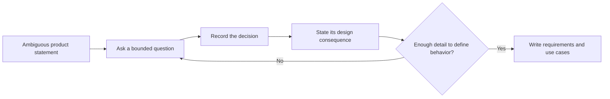
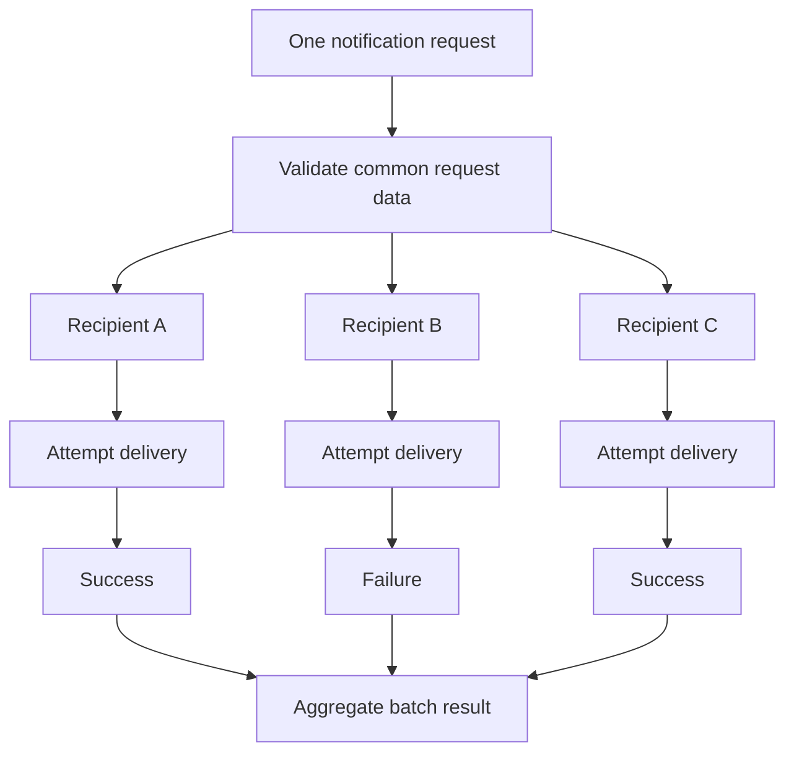
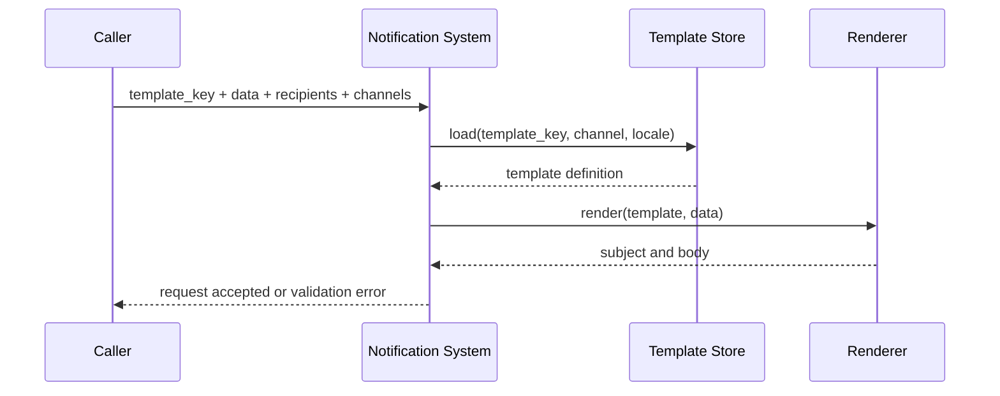
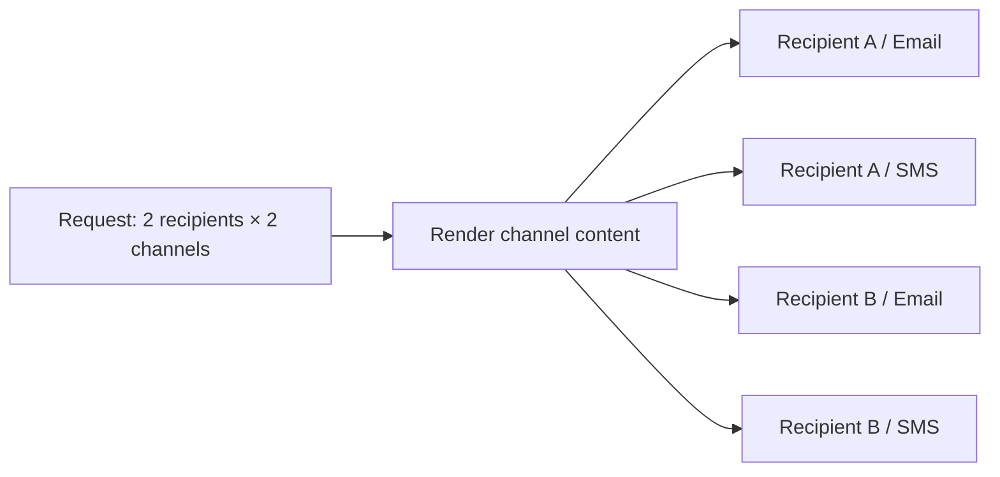

# Phase 1, Concept 1 — Requirement Clarification

## Learning goal

Learn how to turn “design a notification system” into a bounded problem. Good LLD begins with questions because a class model built on unstated assumptions can be internally elegant and still solve the wrong problem.

## 1. Start with the product sentence

A first draft might be:

> The system sends notifications to users.

That sentence is too broad. It does not say who asks for a notification, what channels exist, whether one request targets one user or many, how content is formed, or what “sent” means. Each unanswered question changes the object model.

Use a clarification loop:



## 2. Questions to ask before designing classes

| Area | Clarifying question | Why it matters |
|---|---|---|
| Caller | Who creates a notification: another service, an admin, or an end user? | Defines the public boundary and authorization needs. |
| Audience | Does a request have one recipient or multiple recipients? | Determines whether the request contains one target or a collection and whether partial success exists. |
| Channel | Email, SMS, push, in-app, or several at once? | Drives address validation and channel-specific delivery behavior. |
| Content | Does the caller send final text, use a template, or both? | Determines whether rendering is a system responsibility. |
| Timing | Immediate only, scheduled, or both? | Introduces scheduling state and time-related behavior. |
| Result | Is an accepted request enough, or must delivery be tracked? | Distinguishes request acceptance from actual provider delivery. |
| Failure | What should happen when only some deliveries fail? | Requires per-delivery status rather than one batch boolean. |
| Preferences | Can recipients opt out by channel or notification type? | Adds an eligibility decision before sending. |
| Scale | Tens, thousands, or millions of deliveries? | Influences later architecture, but should not be guessed. |

The two questions explicitly answered for this learning project are the audience and content questions.

## 3. Single recipient versus multiple recipients

### What “recipient” means

A recipient is the person or destination intended to receive a notification. A recipient may have different channel addresses:

```text
Recipient: user-42
email address: user42@example.com
phone number: +91...
push token: device-token-abc
```

The recipient is not the same thing as an address. The person is the domain concept; an email address, phone number, and device token are channel-specific contact points.

### Single-recipient request

One request targets exactly one recipient.

```python
single_request = {
    "recipient_id": "user-42",
    "channel": "email",
    "message": "Your order has shipped.",
}
```

This is easy to validate and return as one result, but callers must make repeated requests for a group announcement.

### Multiple-recipient request

One logical request targets a collection of recipients.

```python
multiple_request = {
    "recipient_ids": ["user-42", "user-73", "user-91"],
    "channel": "email",
    "message": "The planned maintenance starts at 10 PM.",
}
```

This is not merely a plural field name. It creates important behavior:

- the request must reject an empty recipient list;
- duplicate recipients should not receive duplicate deliveries accidentally;
- each recipient can have a different address or eligibility result;
- one failure must not erase successful results for other recipients;
- the system needs an overall batch result plus individual delivery results;
- large recipient sets may later need asynchronous fan-out or chunking.

### Confirmed decision

This project supports **multiple recipients**. A single recipient remains a natural special case: a list containing one recipient.

```python
from dataclasses import dataclass


@dataclass(frozen=True)
class NotificationRequest:
    recipient_ids: tuple[str, ...]
    channel: str
    message: str

    def __post_init__(self) -> None:
        if not self.recipient_ids:
            raise ValueError("At least one recipient is required")
        if len(set(self.recipient_ids)) != len(self.recipient_ids):
            raise ValueError("Recipient IDs must be unique")
```

This example captures only the audience invariant. It is not the final notification-system model.

### Fan-out mental model

One business request becomes several delivery attempts:



The correct aggregate is “partially successful,” not simply `True` or `False`.

## 4. Are templates required?

### Final content versus a template

Final content is already complete:

```python
message = "Hi Nithi, your order ORD-101 has shipped."
```

A template is reusable text with placeholders:

```python
template = "Hi {name}, your order {order_id} has shipped."
data = {"name": "Nithi", "order_id": "ORD-101"}
message = template.format(**data)
```

The template is the reusable pattern; the rendered message is the final content for a particular notification.

### Why templates are useful

Without templates, every caller constructs wording, which causes duplication and inconsistent messages. Templates centralize the stable structure while callers provide changing values.

| Without templates | With templates |
|---|---|
| Caller sends complete prose | Caller sends a template key and data |
| Wording is duplicated across services | Wording has one managed definition |
| Easy for callers to omit required details | Required variables can be validated |
| Branding changes require caller changes | Template content can evolve centrally |
| Localization is difficult to coordinate | Locale can select a template variant |

Templates also create responsibilities:

- identify templates with a stable key such as `order_shipped`;
- define required variables such as `name` and `order_id`;
- reject missing or unexpected variables according to policy;
- support channel-specific forms, because an email body and SMS often differ;
- render safely and preserve a record of the rendered result when auditability is required.

### Confirmed decision

This project requires **notification templates**.

```python
from dataclasses import dataclass
from string import Formatter
from typing import Mapping


@dataclass(frozen=True)
class NotificationTemplate:
    key: str
    subject: str | None
    body: str

    def required_variables(self) -> set[str]:
        fields = {
            field_name
            for _, field_name, _, _ in Formatter().parse(self.body)
            if field_name
        }
        if self.subject:
            fields.update(
                field_name
                for _, field_name, _, _ in Formatter().parse(self.subject)
                if field_name
            )
        return fields

    def render(self, data: Mapping[str, object]) -> "RenderedContent":
        missing = self.required_variables() - data.keys()
        if missing:
            names = ", ".join(sorted(missing))
            raise ValueError(f"Missing template variables: {names}")

        return RenderedContent(
            subject=self.subject.format_map(data) if self.subject else None,
            body=self.body.format_map(data),
        )


@dataclass(frozen=True)
class RenderedContent:
    subject: str | None
    body: str
```

Example:

```python
template = NotificationTemplate(
    key="order_shipped.email.en",
    subject="Order {order_id} shipped",
    body="Hi {name}, your order {order_id} has shipped.",
)

content = template.render({"name": "Nithi", "order_id": "ORD-101"})

assert content.subject == "Order ORD-101 shipped"
assert content.body == "Hi Nithi, your order ORD-101 has shipped."
```

This simple use of `str.format` teaches the contract. Production rendering needs stronger escaping, sandboxing, versioning, and template-engine rules; those are later design concerns.

### Template rendering flow



## 5. Combine both decisions

The clarified request now contains a group of recipients and a template reference:

```python
from dataclasses import dataclass, field
from enum import Enum
from typing import Mapping


class Channel(str, Enum):
    EMAIL = "email"
    SMS = "sms"
    PUSH = "push"


@dataclass(frozen=True)
class TemplatedNotificationRequest:
    recipient_ids: tuple[str, ...]
    channels: tuple[Channel, ...]
    template_key: str
    data: Mapping[str, object] = field(default_factory=dict)

    def __post_init__(self) -> None:
        if not self.recipient_ids:
            raise ValueError("At least one recipient is required")
        if not self.channels:
            raise ValueError("At least one channel is required")
        if not self.template_key.strip():
            raise ValueError("Template key is required")
```

For two recipients and two channels, the system may create as many as four delivery attempts:



This distinction will matter when delivery attempts become explicit objects in a later phase.

## 6. Scope boundary for this learning phase

### In scope

- multiple recipients per logical request;
- one or more of email, SMS, and push;
- reusable templates with variable data;
- request validation;
- per-recipient, per-channel outcomes;
- partial success as a valid aggregate result.

### Deferred, not silently assumed

- scheduled notifications;
- recipient preferences and opt-outs;
- localization rules;
- template versioning and approval workflows;
- provider fallback;
- retries, backoff, queues, and rate limiting;
- exact throughput and latency targets;
- persistence and retention;
- tenant isolation and billing.

“Deferred” means a later phase must make a conscious decision. It does not mean “never.”

## 7. Exercises

Try these before reading the answers.

1. A caller sends three recipient IDs, but one ID appears twice. Should the recipient get two messages?
2. An email template needs `name` and `reset_link`, but the request supplies only `name`. Where should the problem be detected?
3. Two recipients are targeted. One email succeeds and the other fails. Is the entire notification a failure?
4. Is `user-42` an email address, a recipient, or both?
5. Why might SMS and email use separate variants of the same logical template?

## 8. Answers

1. Normally no. Reject duplicates or deduplicate explicitly so accidental duplicates do not produce duplicate deliveries. The chosen policy must be documented.
2. During validation/rendering, before calling the channel provider. The error should name the missing variable.
3. It is partially successful. Preserve both individual results; do not compress them into one misleading boolean.
4. It is a recipient identifier. The email address is a channel-specific address resolved for that recipient.
5. Channels have different capabilities and constraints: email may have a subject and rich body, SMS is short plain text, and push often has a compact title and body.

## Concept 1 checklist

- [x] Ambiguous product statement converted into explicit questions.
- [x] Single versus multiple recipients explained.
- [x] Multiple-recipient scope confirmed.
- [x] Final content versus reusable templates explained.
- [x] Template requirement confirmed.
- [x] Design consequences and deferred questions recorded.


