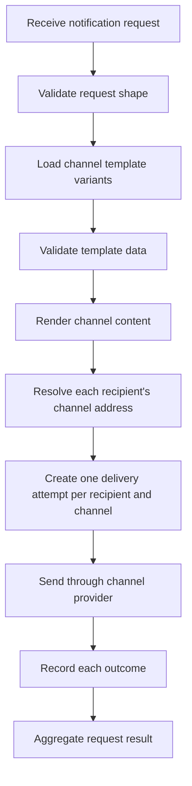
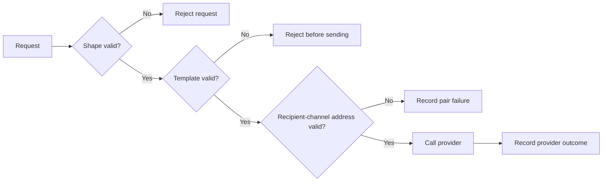
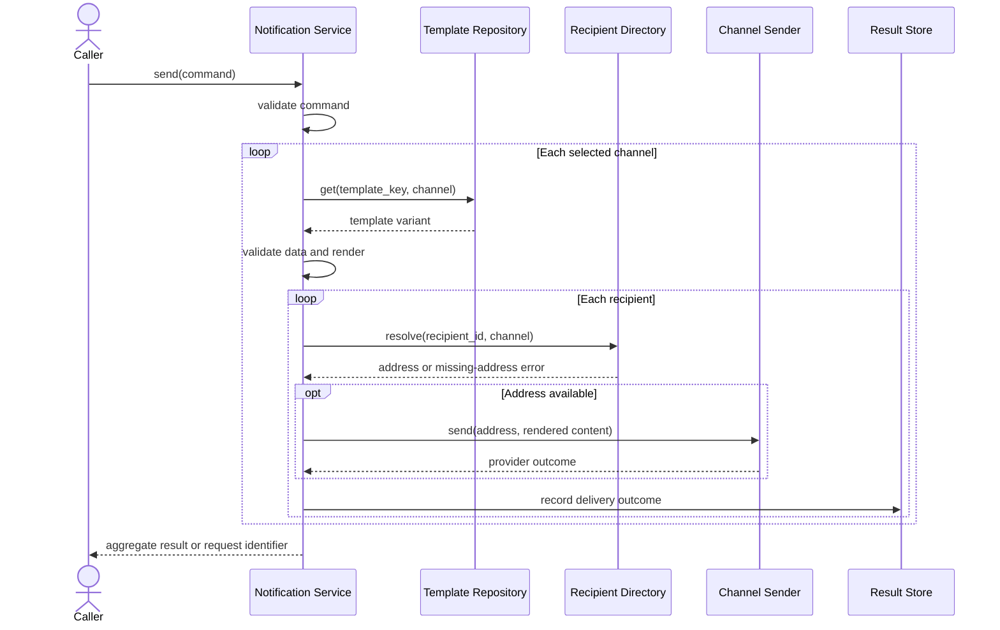

# Phase 1, Concept 2 — Functional Requirements and Use Cases

## Learning goal

Translate the clarified choices into observable system behavior. A functional requirement says what the system does; it should not prematurely prescribe a framework, queue, database, or vendor.

## 1. From decisions to behavior

We know two essential facts:

1. one logical notification can target multiple recipients;
2. notification content is produced from a reusable template.

The main path is therefore:



## 2. Actors and vocabulary

| Term | Meaning |
|---|---|
| Caller | Application or service asking the notification system to send. |
| Notification request | One business intent, template data, recipients, and channels. |
| Recipient | Person or logical target identified by a stable ID. |
| Channel | Delivery medium such as email, SMS, or push. |
| Channel address | Email address, phone number, or device token used by a channel. |
| Template | Reusable content definition identified by a key, channel, and optionally locale/version. |
| Rendered content | Final subject/title/body after variables are substituted. |
| Delivery attempt | Work and outcome for one recipient on one channel. |
| Provider | External or internal adapter that performs the channel-specific send. |

Keeping these terms separate prevents a frequent modeling error: treating a batch request and every physical delivery as the same object.

## 3. Functional requirements table

| ID | Requirement | Acceptance example |
|---|---|---|
| FR-01 | Accept a request with a non-empty set of recipients. | One recipient is valid; an empty list is rejected. |
| FR-02 | Accept one or more supported channels. | `email` and `sms` may be selected together; an unknown channel is rejected. |
| FR-03 | Accept a template key and template data. | `order_shipped` plus `name` and `order_id` is accepted. |
| FR-04 | Load the appropriate template variant for each selected channel. | Email can have a subject while SMS has a shorter body. |
| FR-05 | Validate all required template variables before provider calls. | Missing `order_id` returns a clear validation failure. |
| FR-06 | Render content from the template and supplied data. | `{name}` becomes `Nithi` in the final message. |
| FR-07 | Resolve the selected channel address for every recipient. | Email uses an email address; push uses a device token. |
| FR-08 | Create an independent delivery attempt for every eligible recipient-channel pair. | 3 recipients × 2 channels produces up to 6 attempts. |
| FR-09 | Send each attempt through the matching channel provider. | Email attempts use an email sender, not an SMS sender. |
| FR-10 | Track outcome and error information per delivery attempt. | One invalid phone number does not hide five successful attempts. |
| FR-11 | Return or expose an aggregate request result. | `SUCCEEDED`, `PARTIALLY_SUCCEEDED`, or `FAILED` is derived from individual results. |
| FR-12 | Prevent unintended duplicate recipient entries within one request. | Repeating `user-42` is rejected or explicitly deduplicated according to policy. |

### Functional versus non-functional requirements

“Send an email using the email provider” is functional behavior. “Process one million notifications per minute” is a non-functional capacity target. Both matter, but this phase should not invent latency, throughput, retention, or availability numbers that the product has not supplied.

## 4. Use case UC-01 — Submit a templated notification

### Primary actor

Caller application.

### Preconditions

- the caller is allowed to submit notifications;
- the template key exists for the requested channels;
- recipient IDs refer to resolvable recipients.

### Trigger

The caller submits a request containing recipients, channels, a template key, and variable data.

### Main success flow

1. The system receives the request.
2. It verifies that recipients, channels, and template key are present.
3. It verifies that recipient IDs are unique.
4. It loads a template variant for every selected channel.
5. It verifies that the supplied data contains the required variables.
6. It renders channel-specific content.
7. It resolves each recipient's address for each channel.
8. It creates and sends each recipient-channel delivery attempt.
9. It records every attempt as succeeded or failed.
10. It derives and returns/exposes the aggregate status.

### Alternative flows

- **A1 — Invalid request:** reject before any delivery attempt is sent.
- **A2 — Template not found:** identify the missing template/channel variant.
- **A3 — Missing template variable:** identify all missing required variables.
- **A4 — Recipient lacks a channel address:** fail or skip that recipient-channel pair according to an explicit policy and record the reason.
- **A5 — Provider failure:** record that attempt as failed while allowing independent attempts to continue.
- **A6 — Mixed results:** derive `PARTIALLY_SUCCEEDED`.

### Postconditions

- every attempted recipient-channel pair has an outcome;
- no unreported failure is hidden inside a single success boolean;
- the rendered content used for an attempt can be associated with its outcome when audit requirements are later added.

## 5. Request and result examples

### Input DTO

DTO means data transfer object: the shape used to move request data across the system boundary. It is not automatically the final domain model.

```python
from dataclasses import dataclass, field
from enum import Enum
from typing import Mapping


class Channel(str, Enum):
    EMAIL = "email"
    SMS = "sms"
    PUSH = "push"


@dataclass(frozen=True)
class SendNotificationCommand:
    recipient_ids: tuple[str, ...]
    channels: tuple[Channel, ...]
    template_key: str
    template_data: Mapping[str, object] = field(default_factory=dict)

    def validate(self) -> None:
        errors: list[str] = []

        if not self.recipient_ids:
            errors.append("recipient_ids must not be empty")
        if len(self.recipient_ids) != len(set(self.recipient_ids)):
            errors.append("recipient_ids must not contain duplicates")
        if not self.channels:
            errors.append("channels must not be empty")
        if not self.template_key.strip():
            errors.append("template_key must not be blank")

        if errors:
            raise ValueError("; ".join(errors))
```

Example command:

```python
command = SendNotificationCommand(
    recipient_ids=("user-42", "user-73"),
    channels=(Channel.EMAIL, Channel.SMS),
    template_key="order_shipped",
    template_data={
        "name": "Customer",
        "order_id": "ORD-101",
    },
)

command.validate()
```

In a real personalized batch, `name` may differ per recipient. That suggests two future possibilities: recipient-specific data or template data enriched from a recipient profile. Phase 1 records the question rather than hiding it.

### Per-delivery result

```python
from dataclasses import dataclass
from enum import Enum


class DeliveryStatus(str, Enum):
    SUCCEEDED = "succeeded"
    FAILED = "failed"


@dataclass(frozen=True)
class DeliveryResult:
    recipient_id: str
    channel: Channel
    status: DeliveryStatus
    provider_message_id: str | None = None
    error_code: str | None = None
    error_message: str | None = None
```

### Aggregate batch result

```python
class RequestStatus(str, Enum):
    SUCCEEDED = "succeeded"
    PARTIALLY_SUCCEEDED = "partially_succeeded"
    FAILED = "failed"


@dataclass(frozen=True)
class NotificationResult:
    deliveries: tuple[DeliveryResult, ...]

    @property
    def status(self) -> RequestStatus:
        if not self.deliveries:
            return RequestStatus.FAILED

        success_count = sum(
            result.status is DeliveryStatus.SUCCEEDED
            for result in self.deliveries
        )

        if success_count == len(self.deliveries):
            return RequestStatus.SUCCEEDED
        if success_count == 0:
            return RequestStatus.FAILED
        return RequestStatus.PARTIALLY_SUCCEEDED
```

Example partial success:

```python
result = NotificationResult(
    deliveries=(
        DeliveryResult(
            recipient_id="user-42",
            channel=Channel.EMAIL,
            status=DeliveryStatus.SUCCEEDED,
            provider_message_id="email-9001",
        ),
        DeliveryResult(
            recipient_id="user-73",
            channel=Channel.EMAIL,
            status=DeliveryStatus.FAILED,
            error_code="INVALID_ADDRESS",
            error_message="Recipient email address is invalid",
        ),
    )
)

assert result.status is RequestStatus.PARTIALLY_SUCCEEDED
```

## 6. Validation layers

Not every validation belongs in the same place.

| Layer | Example checks | Failure meaning |
|---|---|---|
| Request shape | Recipients not empty, channel supported, template key present | The caller submitted an invalid command. |
| Template contract | Template exists and required variables are present | Content cannot be produced. |
| Recipient resolution | Recipient exists and has the selected channel address | A particular delivery cannot be addressed. |
| Provider response | Vendor accepts or rejects the send | An addressed delivery attempt succeeded or failed. |

This layered view prevents provider failures from being mixed with caller validation errors.



## 7. Responsibility sketch — not yet a final class design

| Responsibility | Candidate collaborator | What it should not need to know |
|---|---|---|
| Validate the incoming command | Request validator | Vendor SDK details |
| Retrieve templates | Template repository | How SMS is transmitted |
| Render content | Template renderer | Recipient persistence details |
| Resolve channel addresses | Recipient directory | Template syntax |
| Coordinate the use case | Notification service | Low-level HTTP calls to every provider |
| Perform channel send | Email/SMS/push sender | The entire batch workflow |
| Store or expose outcomes | Delivery result repository | How content was rendered |

The table is a bridge to later LLD. It separates responsibilities without prematurely locking every row into one concrete class.

## 8. End-to-end sequence



The response may eventually be asynchronous and return a request identifier before delivery finishes. This phase defines required outcomes without choosing synchronous or asynchronous execution.

## 9. Worked scenario

Request:

- recipients: `user-42`, `user-73`;
- channels: email and SMS;
- template: `order_shipped`;
- data: `order_id = ORD-101`.

Expected expansion:

| Attempt | Recipient | Channel | Possible result |
|---:|---|---|---|
| 1 | user-42 | Email | Succeeded |
| 2 | user-42 | SMS | Succeeded |
| 3 | user-73 | Email | Failed: invalid address |
| 4 | user-73 | SMS | Succeeded |

The request status is `PARTIALLY_SUCCEEDED` because three of four independent attempts succeeded. The caller can inspect the failed pair and decide what to do; successful deliveries are not mislabeled as failures.

## 10. Exercises

1. Write the maximum number of delivery attempts for 20 recipients and 3 channels.
2. Classify each item as request-shape, template, recipient-resolution, or provider validation:
   - empty recipient list;
   - missing `{order_id}`;
   - recipient has no phone number;
   - SMS vendor rejects a valid phone number.
3. If all email attempts succeed but all SMS attempts fail, what is the aggregate status?
4. Why should `NotificationResult` contain individual results rather than only an aggregate status?
5. A caller asks to send both email and push, but the template exists only for email. Should the system silently reuse the email body for push?

## 11. Answers

1. Up to `20 × 3 = 60` recipient-channel delivery attempts.
2. Empty list: request shape. Missing variable: template contract. No phone: recipient resolution. Vendor rejection: provider outcome.
3. `PARTIALLY_SUCCEEDED`, assuming at least one email succeeded and at least one SMS failed.
4. The aggregate cannot identify which recipient/channel failed, preserve error details, support targeted retries, or explain a partial success.
5. No, not unless an explicit fallback rule exists. A missing channel variant should be reported during template validation; silently adapting content creates surprising behavior.

## 12. Phase 1 completion checklist

- [x] Actors and core vocabulary defined.
- [x] Multiple recipients represented as one request that fans out.
- [x] Templates and variable validation included.
- [x] Functional requirements stated independently of technology.
- [x] Main and alternative use-case flows documented.
- [x] Per-recipient, per-channel results modeled.
- [x] Partial success derived explicitly.
- [x] Python examples included.
- [x] Mermaid flow and sequence diagrams included.
- [x] Exercises and answers included.
- [x] Later implementation decisions kept out of Phase 1.

## Phase 1 takeaway

The central modeling insight is:

> A notification request expresses one business intent; delivery attempts express the independent work required to realize that intent for every recipient and channel.

That distinction, combined with a clear template contract, gives later object modeling a stable foundation.

