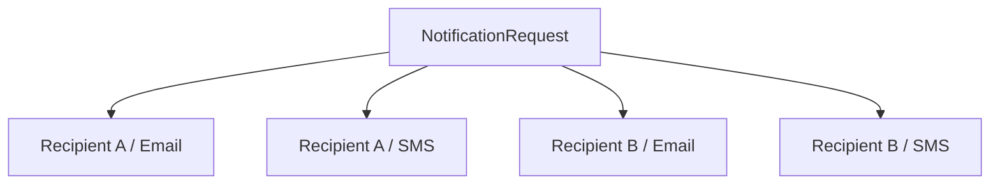

# Phase 2, Concept 1 — Identify Core Objects

## Learning goal

Turn the Phase 1 requirements into a small object model. Do not create a class for every noun. Ask whether a concept has identity, state and a lifecycle, represents an immutable value, or performs a focused operation.

## Candidate objects

| Object | Kind | Responsibility |
|---|---|---|
| `NotificationRequest` | Entity | Represents one business intention to notify recipients. |
| `Recipient` | Entity | Represents a stable logical target and its contact points. |
| `NotificationTemplate` | Entity or identified definition | Defines reusable, channel-specific content. |
| `RenderedContent` | Value object | Contains the final subject/title/body. |
| `DeliveryAttempt` | Entity | Tracks one recipient-channel delivery and its lifecycle. |
| `ChannelSender` | Service boundary | Performs channel-specific delivery. |
| `Channel` and `DeliveryStatus` | Enums | Define closed sets of valid values. |

## Request versus delivery attempt

One request expresses one business intention. It may create many physical sends:



The request and attempt must remain separate because each attempt can have a different destination, provider identifier, status, and failure reason.

## Initial model

```python
from dataclasses import dataclass, field
from enum import Enum
from typing import Mapping
from uuid import UUID, uuid4


class Channel(str, Enum):
    EMAIL = "email"
    SMS = "sms"
    PUSH = "push"


class DeliveryStatus(str, Enum):
    PENDING = "pending"
    SUCCEEDED = "succeeded"
    FAILED = "failed"


@dataclass(frozen=True)
class NotificationRequest:
    recipient_ids: tuple[str, ...]
    channels: tuple[Channel, ...]
    template_key: str
    template_data: Mapping[str, object]
    request_id: UUID = field(default_factory=uuid4)


@dataclass
class DeliveryAttempt:
    request_id: UUID
    recipient_id: str
    channel: Channel
    attempt_id: UUID = field(default_factory=uuid4)
    status: DeliveryStatus = DeliveryStatus.PENDING
    error_message: str | None = None
```

`NotificationRequest` is immutable because its original intent should remain stable. `DeliveryAttempt` changes as work moves from pending to a terminal result.

## Expanding the request

```python
def create_attempts(
    request: NotificationRequest,
) -> tuple[DeliveryAttempt, ...]:
    return tuple(
        DeliveryAttempt(
            request_id=request.request_id,
            recipient_id=recipient_id,
            channel=channel,
        )
        for recipient_id in request.recipient_ids
        for channel in request.channels
    )
```

Two recipients and two channels create four attempts. This Cartesian-product rule is visible and testable.

## Classification exercise

Classify each concept as an entity, value object, service, or enum:

1. `NotificationRequest`
2. `DeliveryAttempt`
3. `RenderedContent`
4. `TemplateRenderer`
5. `Channel`
6. `Recipient`

### Answers

1. Entity: it has a request identity.
2. Entity: it has identity and a lifecycle.
3. Value object: its content defines its value.
4. Service: it performs focused rendering behavior.
5. Enum/value: it names a supported delivery medium.
6. Entity: it normally has a stable identity independent of any request.

## Key takeaway

> Model one business request separately from the independent delivery work created by that request.


