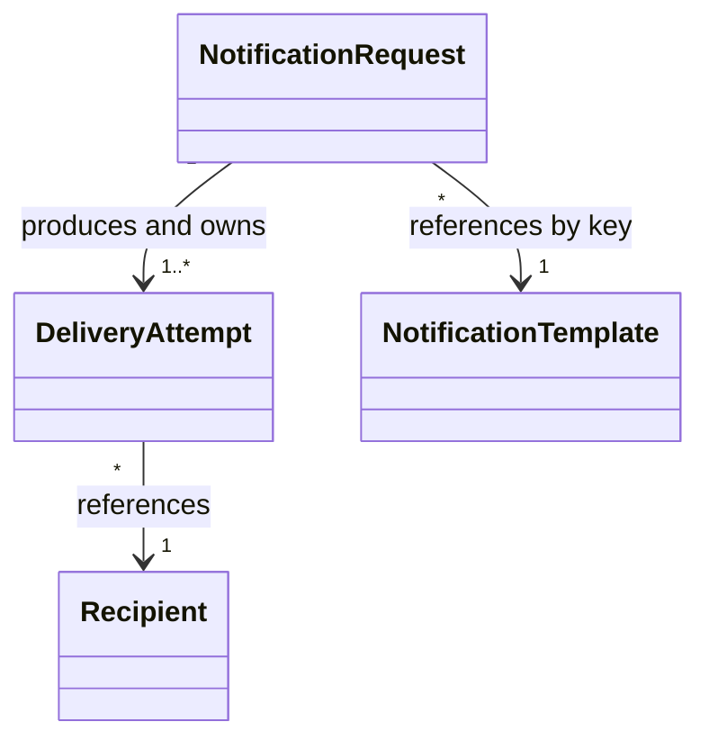

# Phase 2, Concept 2 — Relationships and Ownership

## Learning goal

Decide how objects relate and which object owns each piece of data. Ownership concerns lifecycle; a reference points to something that exists independently.

## Relationship overview



## Ownership rule

Ask: if this object disappears, should the associated object or value disappear with it?

- A request owns its delivery-attempt lifecycle because those attempts exist only to fulfill it.
- A request references a template because a shared template exists before and after one request.
- An attempt references a recipient because the recipient exists independently.
- A recipient owns its current contact points.
- An attempt owns the destination snapshot used for its historical send.

## Recipient contact points

```python
from dataclasses import dataclass
from enum import Enum


class Channel(str, Enum):
    EMAIL = "email"
    SMS = "sms"
    PUSH = "push"


@dataclass(frozen=True)
class ContactPoints:
    email: str | None = None
    phone_number: str | None = None
    push_token: str | None = None


@dataclass(frozen=True)
class Recipient:
    recipient_id: str
    contact_points: ContactPoints

    def destination_for(self, channel: Channel) -> str:
        destinations = {
            Channel.EMAIL: self.contact_points.email,
            Channel.SMS: self.contact_points.phone_number,
            Channel.PUSH: self.contact_points.push_token,
        }
        destination = destinations[channel]
        if destination is None:
            raise ValueError(
                f"Recipient {self.recipient_id} has no {channel.value} destination"
            )
        return destination
```

`ContactPoints` has no independent identity; it is a value belonging to the recipient.

## Why an attempt stores a destination snapshot

```python
from dataclasses import dataclass
from uuid import UUID


@dataclass
class DeliveryAttempt:
    request_id: UUID
    recipient_id: str
    channel: Channel
    destination: str
```

If a recipient changes from `old@example.com` to `new@example.com`, a historical attempt must still report the actual address used. The attempt references the recipient but owns the snapshot.

## Channel-specific template variants

```python
@dataclass(frozen=True)
class NotificationTemplate:
    template_key: str
    channel: Channel
    body: str
    subject: str | None = None
```

```text
order_shipped
├── email: subject + body
├── sms: short body
└── push: title + compact body
```

The request references the logical key `order_shipped`. The workflow selects the matching channel variant instead of asking a sender to reinterpret an email template.

## Relationship table

| Object | Owns | References |
|---|---|---|
| `NotificationRequest` | Original request data and attempt lifecycle | Template key and recipient IDs |
| `Recipient` | Current contact points | Nothing required yet |
| `NotificationTemplate` | Channel-specific content definition | Logical template key |
| `DeliveryAttempt` | Status, destination snapshot and errors | Request ID and recipient ID |

## Exercise and answers

1. A request uses `order_shipped`: **reference**, because the shared template is independent.
2. A recipient has an email address: **ownership**, because it is part of the recipient's contact information.
3. A request creates four attempts: **ownership**, because those attempts exist for the request.
4. An attempt targets `user-42`: **reference**, because the recipient exists independently.
5. An attempt remembers the address used: **ownership**, because it is historical attempt data.

## Key takeaway

> Own data whose lifecycle belongs to the object; reference objects that exist independently.


