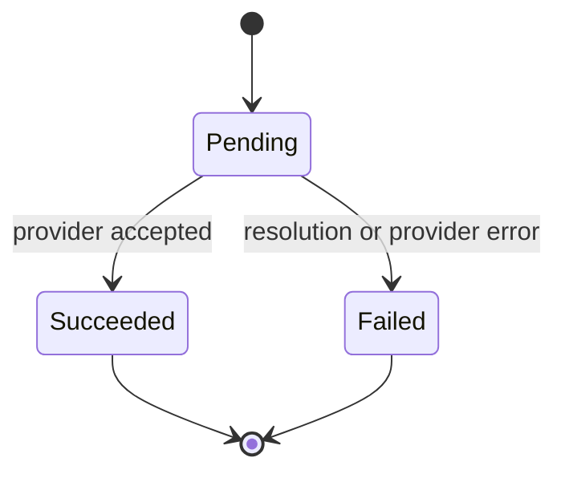

# Phase 2, Concept 3 — Responsibilities and Method Placement

## Learning goal

Place behavior close to the data and rules it protects. The orchestration service coordinates a use case; it should not absorb every validation, rendering, state, provider and persistence rule.

## Responsibility map

| Responsibility | Owner |
|---|---|
| Protect request invariants | `NotificationRequest` |
| Resolve a channel destination | `Recipient` |
| Define required variables | `NotificationTemplate` |
| Produce final content | `TemplateRenderer` |
| Protect status transitions | `DeliveryAttempt` |
| Deliver through a channel | `ChannelSender` |
| Coordinate the use case | `NotificationService` |

## Request invariants

```python
from dataclasses import dataclass, field
from enum import Enum
from typing import Mapping
from uuid import UUID, uuid4


class Channel(str, Enum):
    EMAIL = "email"
    SMS = "sms"
    PUSH = "push"


@dataclass(frozen=True)
class NotificationRequest:
    recipient_ids: tuple[str, ...]
    channels: tuple[Channel, ...]
    template_key: str
    template_data: Mapping[str, object]
    request_id: UUID = field(default_factory=uuid4)

    def __post_init__(self) -> None:
        if not self.recipient_ids:
            raise ValueError("At least one recipient is required")
        if len(self.recipient_ids) != len(set(self.recipient_ids)):
            raise ValueError("Recipient IDs must be unique")
        if not self.channels:
            raise ValueError("At least one channel is required")
        if len(self.channels) != len(set(self.channels)):
            raise ValueError("Channels must be unique")
        if not self.template_key.strip():
            raise ValueError("Template key is required")
```

An invalid request cannot travel deeper into the system.

## Template contract and renderer

```python
from string import Formatter


@dataclass(frozen=True)
class NotificationTemplate:
    template_key: str
    channel: Channel
    body: str
    subject: str | None = None

    def required_variables(self) -> set[str]:
        text_parts = [self.body]
        if self.subject is not None:
            text_parts.append(self.subject)

        return {
            field_name
            for text in text_parts
            for _, field_name, _, _ in Formatter().parse(text)
            if field_name
        }


@dataclass(frozen=True)
class RenderedContent:
    body: str
    subject: str | None = None


class TemplateRenderer:
    def render(
        self,
        template: NotificationTemplate,
        data: Mapping[str, object],
    ) -> RenderedContent:
        missing = template.required_variables() - data.keys()
        if missing:
            names = ", ".join(sorted(missing))
            raise ValueError(f"Missing template variables: {names}")

        return RenderedContent(
            subject=(
                template.subject.format_map(data)
                if template.subject is not None
                else None
            ),
            body=template.body.format_map(data),
        )
```

Separating rendering becomes useful when escaping, localization, sandboxing or a real template engine is introduced.

## Delivery state transitions



```python
class DeliveryStatus(str, Enum):
    PENDING = "pending"
    SUCCEEDED = "succeeded"
    FAILED = "failed"


@dataclass
class DeliveryAttempt:
    recipient_id: str
    channel: Channel
    destination: str
    status: DeliveryStatus = DeliveryStatus.PENDING
    provider_message_id: str | None = None
    error_code: str | None = None
    error_message: str | None = None

    def mark_succeeded(self, provider_message_id: str) -> None:
        self._require_pending()
        self.status = DeliveryStatus.SUCCEEDED
        self.provider_message_id = provider_message_id
        self.error_code = None
        self.error_message = None

    def mark_failed(self, code: str, message: str) -> None:
        self._require_pending()
        if not code.strip() or not message.strip():
            raise ValueError("Failure code and message are required")
        self.status = DeliveryStatus.FAILED
        self.error_code = code
        self.error_message = message
        self.provider_message_id = None

    def _require_pending(self) -> None:
        if self.status is not DeliveryStatus.PENDING:
            raise ValueError(
                f"Cannot change a {self.status.value} delivery"
            )
```

The object prevents impossible or accidental terminal-to-terminal transitions.

## Avoid the god service

A poor `NotificationService` validates every field, reads contact fields directly, parses templates, calls all vendors, mutates status fields and writes database rows. It changes whenever any one of those rules changes.

A cohesive service instead delegates specialized behavior and owns only the use-case sequence.

## Exercise and answers

1. Verify a non-empty recipient set: `NotificationRequest`.
2. Find the recipient phone number: `Recipient`.
3. Discover a missing `{order_id}`: `NotificationTemplate` plus `TemplateRenderer`.
4. Mark an attempt failed: `DeliveryAttempt`.
5. Call an SMS vendor: an SMS `ChannelSender` implementation.
6. Coordinate templates, recipients, senders and results: `NotificationService`.

## Key takeaway

> The application service controls the sequence; domain objects protect their rules; focused collaborators perform specialized work.


