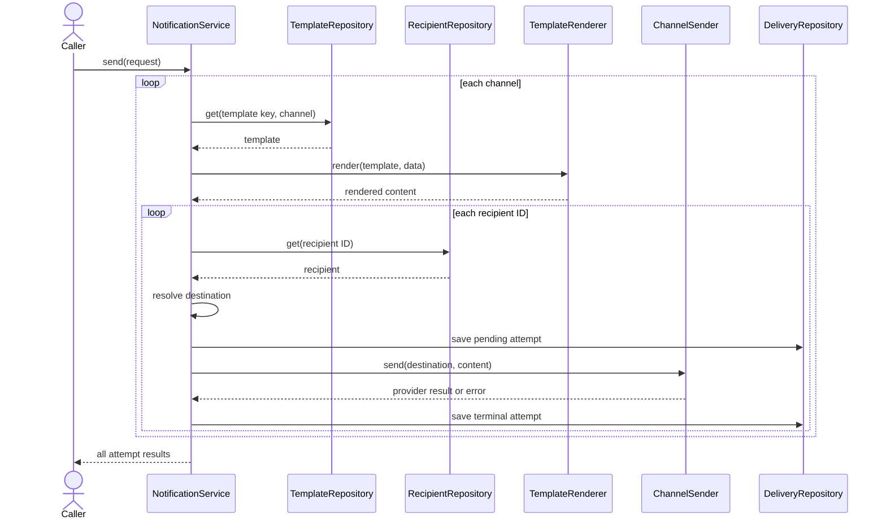

# Phase 2, Concept 4 — Interfaces, Orchestration, and Composition

## Learning goal

Finish the Phase 2 model by defining what the use case needs from external collaborators. These interfaces—often called ports—keep business workflow independent of databases, provider SDKs and web frameworks.

## 1. Depend on capabilities

The notification workflow needs to:

- find a template variant;
- find a recipient;
- send through a channel;
- save requests and attempts.

It does not need to know whether those operations use PostgreSQL, an HTTP API, an in-memory dictionary, SendGrid, Twilio or Firebase.

```python
from typing import Protocol


class TemplateRepository(Protocol):
    def get(
        self,
        template_key: str,
        channel: Channel,
    ) -> NotificationTemplate:
        ...


class RecipientRepository(Protocol):
    def get(self, recipient_id: str) -> Recipient:
        ...


class DeliveryRepository(Protocol):
    def save(self, attempt: DeliveryAttempt) -> None:
        ...
```

`Protocol` provides structural typing: an implementation satisfies the contract when it supplies compatible methods.

## 2. Sender interface

```python
from dataclasses import dataclass


@dataclass(frozen=True)
class ProviderResult:
    provider_message_id: str


class ChannelSender(Protocol):
    def send(
        self,
        destination: str,
        content: RenderedContent,
    ) -> ProviderResult:
        ...
```

Concrete senders adapt external providers:

```python
class EmailSender:
    def send(
        self,
        destination: str,
        content: RenderedContent,
    ) -> ProviderResult:
        if content.subject is None:
            raise ValueError("Email content requires a subject")

        # Provider-specific API call belongs here.
        return ProviderResult(provider_message_id="email-1001")
```

The orchestration layer sees `ChannelSender`, not vendor-specific requests and responses.

## 3. Orchestration service

The service receives collaborators through its constructor:

```python
from collections.abc import Mapping


class NotificationService:
    def __init__(
        self,
        templates: TemplateRepository,
        recipients: RecipientRepository,
        deliveries: DeliveryRepository,
        renderer: TemplateRenderer,
        senders: Mapping[Channel, ChannelSender],
    ) -> None:
        self._templates = templates
        self._recipients = recipients
        self._deliveries = deliveries
        self._renderer = renderer
        self._senders = senders
```

This is dependency injection: the service receives dependencies instead of constructing concrete infrastructure internally.

## 4. End-to-end collaboration



## 5. Orchestration implementation

```python
class ProviderDeliveryError(Exception):
    def __init__(self, code: str, message: str) -> None:
        self.code = code
        self.message = message
        super().__init__(message)


class NotificationService:
    def __init__(
        self,
        templates: TemplateRepository,
        recipients: RecipientRepository,
        deliveries: DeliveryRepository,
        renderer: TemplateRenderer,
        senders: Mapping[Channel, ChannelSender],
    ) -> None:
        self._templates = templates
        self._recipients = recipients
        self._deliveries = deliveries
        self._renderer = renderer
        self._senders = senders

    def send(
        self,
        request: NotificationRequest,
    ) -> tuple[DeliveryAttempt, ...]:
        attempts: list[DeliveryAttempt] = []

        for channel in request.channels:
            template = self._templates.get(
                request.template_key,
                channel,
            )
            content = self._renderer.render(
                template,
                request.template_data,
            )
            sender = self._senders[channel]

            for recipient_id in request.recipient_ids:
                recipient = self._recipients.get(recipient_id)

                try:
                    destination = recipient.destination_for(channel)
                except ValueError as error:
                    attempt = DeliveryAttempt(
                        recipient_id=recipient_id,
                        channel=channel,
                        destination="",
                    )
                    attempt.mark_failed("MISSING_DESTINATION", str(error))
                    self._deliveries.save(attempt)
                    attempts.append(attempt)
                    continue

                attempt = DeliveryAttempt(
                    recipient_id=recipient_id,
                    channel=channel,
                    destination=destination,
                )
                self._deliveries.save(attempt)

                try:
                    provider_result = sender.send(destination, content)
                except ProviderDeliveryError as error:
                    attempt.mark_failed(error.code, error.message)
                else:
                    attempt.mark_succeeded(
                        provider_result.provider_message_id
                    )

                self._deliveries.save(attempt)
                attempts.append(attempt)

        return tuple(attempts)
```

This synchronous code demonstrates object collaboration. It does not yet solve retries, transactions, concurrency, queues or idempotency; those belong to later phases.

## 6. Composition root

The one place that chooses concrete implementations is the composition root, such as application startup:

```python
service = NotificationService(
    templates=PostgresTemplateRepository(connection),
    recipients=PostgresRecipientRepository(connection),
    deliveries=PostgresDeliveryRepository(connection),
    renderer=TemplateRenderer(),
    senders={
        Channel.EMAIL: SendGridEmailSender(sendgrid_client),
        Channel.SMS: TwilioSmsSender(twilio_client),
        Channel.PUSH: FirebasePushSender(firebase_client),
    },
)
```

These concrete class names illustrate placement only; Phase 2 does not select actual vendors or persistence technology.

## 7. Testing without external systems

```python
class FakeSender:
    def __init__(self) -> None:
        self.calls: list[tuple[str, RenderedContent]] = []

    def send(
        self,
        destination: str,
        content: RenderedContent,
    ) -> ProviderResult:
        self.calls.append((destination, content))
        return ProviderResult(provider_message_id="fake-1")
```

Because the service depends on a contract, tests can use deterministic in-memory repositories and fake senders. No network or database is necessary to test the business workflow.

## 8. Design review

| Question | Phase 2 answer |
|---|---|
| What represents one business intention? | `NotificationRequest` |
| What represents one physical send? | `DeliveryAttempt` |
| Who owns current addresses? | `Recipient` through `ContactPoints` |
| Who owns the address historically used? | `DeliveryAttempt` |
| Who validates template variables? | Template contract plus renderer |
| Who protects delivery transitions? | `DeliveryAttempt` |
| Who talks to an external provider? | A channel-specific sender adapter |
| Who coordinates everything? | `NotificationService` |
| Where are concrete technologies selected? | The composition root |

## 9. Exercise

1. Why should `NotificationService` not construct `SendGridEmailSender` itself?
2. Which collaborator should be replaced by a fake to test provider success?
3. Where should PostgreSQL queries for recipients live?
4. Does a protocol mean the domain knows which vendor is used?
5. What important production concerns remain intentionally unresolved?

## 10. Answers

1. Construction would couple workflow logic to one vendor and make testing harder.
2. Replace the `ChannelSender` implementation with a fake.
3. In a concrete `RecipientRepository` adapter.
4. No. The protocol describes required behavior without selecting an implementation.
5. Transactions, persistence schema, asynchronous execution, retries, idempotency, concurrency, observability and APIs.

## Phase 2 completion checklist

- [x] Core entities, values, enums and services identified.
- [x] Request and delivery-attempt lifecycles separated.
- [x] Ownership and references documented.
- [x] Destination snapshot reasoning captured.
- [x] Responsibilities placed with cohesive objects.
- [x] Delivery state transitions protected.
- [x] Repository and sender interfaces defined.
- [x] End-to-end orchestration demonstrated.
- [x] Dependency injection and composition explained.
- [x] Test doubles demonstrated.

## Phase 2 takeaway

> Stable domain concepts and small interfaces let the notification workflow remain understandable even when databases, queues and providers change around it.

