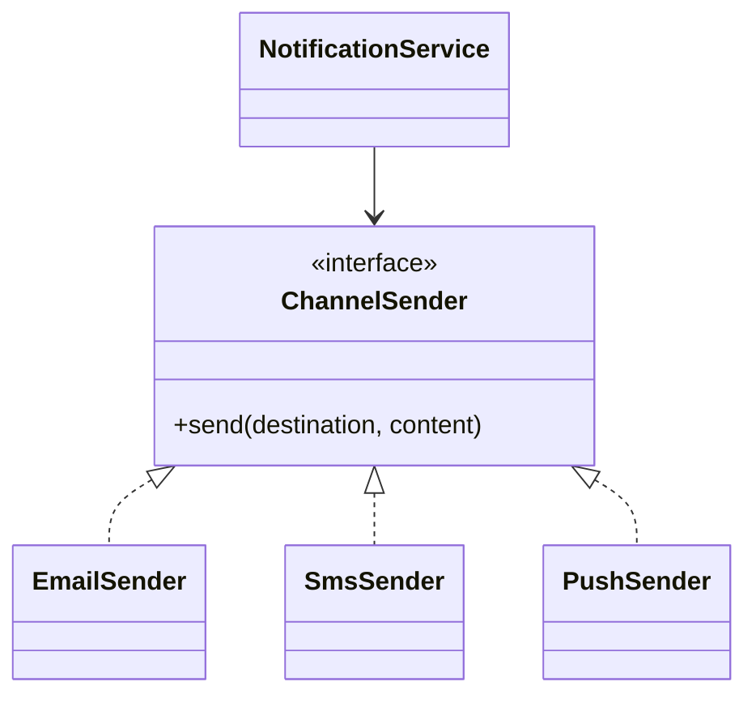

# Phase 3, Concept 1 — Strategy Pattern

## Goal

Keep the delivery workflow stable while allowing email, SMS and push to implement different sending algorithms and channel rules.

## The branching problem

```python
def send_notification(channel, destination, content):
    if channel == "email":
        ...
    elif channel == "sms":
        ...
    elif channel == "push":
        ...
```

This mixes provider dependencies and channel-specific rules in one function. Every new channel modifies stable orchestration logic.

## Strategy contract

```python
from dataclasses import dataclass
from typing import Protocol


@dataclass(frozen=True)
class RenderedContent:
    body: str
    subject: str | None = None


@dataclass(frozen=True)
class ProviderResult:
    provider_message_id: str


class ChannelSender(Protocol):
    def send(
        self,
        destination: str,
        content: RenderedContent,
    ) -> ProviderResult:
        ...
```

## Concrete strategies

```python
class EmailSender:
    def __init__(self, provider) -> None:
        self._provider = provider

    def send(self, destination, content) -> ProviderResult:
        if content.subject is None:
            raise ValueError("Email content requires a subject")
        message_id = self._provider.send_email(
            to=destination,
            subject=content.subject,
            body=content.body,
        )
        return ProviderResult(message_id)


class SmsSender:
    MAX_LENGTH = 160

    def __init__(self, provider) -> None:
        self._provider = provider

    def send(self, destination, content) -> ProviderResult:
        if len(content.body) > self.MAX_LENGTH:
            raise ValueError("SMS body exceeds 160 characters")
        message_id = self._provider.send_sms(
            to=destination,
            body=content.body,
        )
        return ProviderResult(message_id)
```

Each strategy owns rules for its channel; the service sees one interface.



## Adding a channel

A WhatsApp sender implements the same contract and is registered at startup. Existing orchestration does not change. This supports the Open/Closed Principle without pretending every `if` statement is a design flaw.

## Exercise and answers

1. Strategy interface: `ChannelSender`.
2. Concrete strategies: `EmailSender`, `SmsSender`, `PushSender`.
3. SMS length rules belong to `SmsSender`, not `NotificationService`.
4. Strategy is appropriate because one step genuinely varies while the workflow remains stable.

## Takeaway

> Use Strategy when the use-case sequence stays the same but one algorithm varies by channel or policy.


