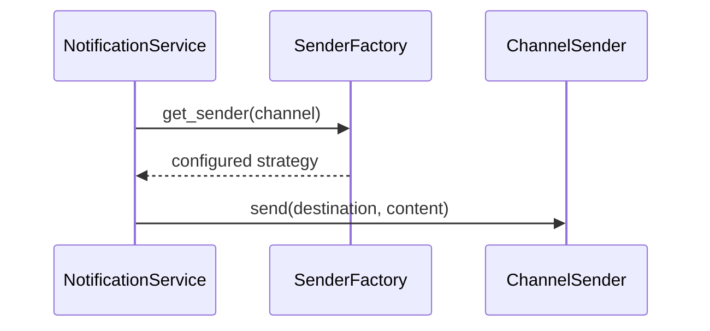

# Phase 3, Concept 2 — Factory Pattern

## Goal

Select the appropriate channel strategy without scattering construction or lookup logic through the application.

## Factory and Strategy answer different questions

| Pattern | Question |
|---|---|
| Strategy | How is this channel delivered? |
| Factory | Which configured strategy handles this channel? |

## Narrow selection factory

```python
from collections.abc import Mapping


class UnsupportedChannelError(Exception):
    pass


class SenderFactory:
    def __init__(
        self,
        senders: Mapping[Channel, ChannelSender],
    ) -> None:
        if not senders:
            raise ValueError("At least one sender is required")
        self._senders = dict(senders)

    def get_sender(self, channel: Channel) -> ChannelSender:
        try:
            return self._senders[channel]
        except KeyError as error:
            raise UnsupportedChannelError(channel.value) from error

    def supports(self, channel: Channel) -> bool:
        return channel in self._senders
```

Composition supplies reusable, configured strategies:

```python
factory = SenderFactory(
    senders={
        Channel.EMAIL: EmailSender(email_provider),
        Channel.SMS: SmsSender(sms_provider),
        Channel.PUSH: PushSender(push_provider),
    }
)
```



## Reuse versus recreation

Senders normally hold provider clients but no delivery-specific state. Reuse the configured sender; keep delivery state in `DeliveryAttempt`.

## Avoid a service locator

Do not turn the factory into `get("database")`, `get("logger")`, `get("repository")`, and `get("sender")`. Hidden dependencies make code harder to understand and test. Keep the contract focused on sender selection.

## Test example

```python
def test_factory_returns_registered_sender() -> None:
    fake_sender = FakeSender()
    factory = SenderFactory({Channel.EMAIL: fake_sender})

    assert factory.get_sender(Channel.EMAIL) is fake_sender
```

## Exercise and answers

1. Strategy executes behavior; Factory selects it.
2. A sender normally should not be recreated for every attempt.
3. Concrete providers and credentials belong in the composition root.
4. Unsupported channels should produce an explicit error instead of a `None` failure later.

## Takeaway

> A narrow factory centralizes strategy selection without hiding unrelated application dependencies.


