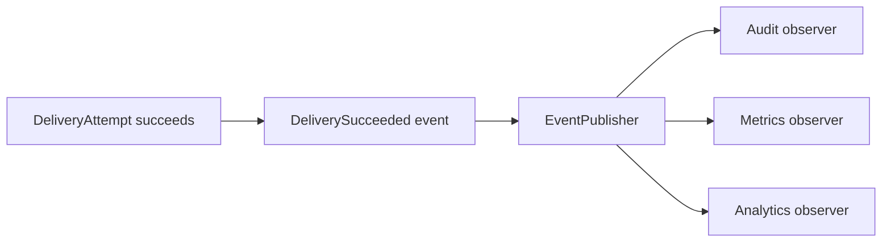

# Phase 3, Concept 4 — Observer and Domain Events

## Goal

Notify independent parts of the system after meaningful delivery changes without coupling `NotificationService` to analytics, auditing, metrics or downstream workflows.

## The coupling problem

After a successful delivery, code might directly update analytics, write an audit entry, increment metrics and call another service. Adding each reaction makes the sending workflow harder to change and test.

Observer separates the fact that something happened from the independent reactions to it.

## Domain events

Use immutable event values:

```python
from dataclasses import dataclass
from datetime import datetime
from uuid import UUID


@dataclass(frozen=True)
class DeliverySucceeded:
    attempt_id: UUID
    request_id: UUID
    recipient_id: str
    channel: Channel
    provider_message_id: str
    occurred_at: datetime


@dataclass(frozen=True)
class DeliveryFailed:
    attempt_id: UUID
    request_id: UUID
    recipient_id: str
    channel: Channel
    error_code: str
    retryable: bool
    occurred_at: datetime
```

An event describes a completed fact in past tense. It should contain identifiers and facts observers need, not live mutable domain objects.

## Event publisher contract

```python
from typing import Protocol, TypeAlias


DomainEvent: TypeAlias = DeliverySucceeded | DeliveryFailed


class EventPublisher(Protocol):
    def publish(self, event: DomainEvent) -> None:
        ...
```

## In-memory observer implementation

```python
from collections import defaultdict
from collections.abc import Callable


EventHandler = Callable[[DomainEvent], None]


class InMemoryEventPublisher:
    def __init__(self) -> None:
        self._handlers: dict[type, list[EventHandler]] = defaultdict(list)

    def subscribe(
        self,
        event_type: type,
        handler: EventHandler,
    ) -> None:
        self._handlers[event_type].append(handler)

    def publish(self, event: DomainEvent) -> None:
        for handler in self._handlers[type(event)]:
            handler(event)
```

## Independent observers

```python
class AuditDeliverySuccess:
    def __init__(self, audit_log) -> None:
        self._audit_log = audit_log

    def __call__(self, event: DeliverySucceeded) -> None:
        self._audit_log.record(
            action="delivery_succeeded",
            subject_id=str(event.attempt_id),
        )


class CountDeliverySuccess:
    def __init__(self, metrics) -> None:
        self._metrics = metrics

    def __call__(self, event: DeliverySucceeded) -> None:
        self._metrics.increment(
            "notification_delivery_succeeded",
            tags={"channel": event.channel.value},
        )
```

Composition registers observers:

```python
publisher.subscribe(
    DeliverySucceeded,
    AuditDeliverySuccess(audit_log),
)
publisher.subscribe(
    DeliverySucceeded,
    CountDeliverySuccess(metrics),
)
```



The delivery workflow does not need direct dependencies on every observer.

## Publishing from the application service

After a provider succeeds, update and persist the attempt before announcing success:

```python
attempt.mark_succeeded(result.provider_message_id)
delivery_repository.save(attempt)

event_publisher.publish(
    DeliverySucceeded(
        attempt_id=attempt.attempt_id,
        request_id=attempt.request_id,
        recipient_id=attempt.recipient_id,
        channel=attempt.channel,
        provider_message_id=result.provider_message_id,
        occurred_at=clock.now(),
    )
)
```

Publishing before saving risks announcing a success whose state was never committed.

## Observer failure policy

If a metrics observer fails after the message was sent, should the delivery become failed? Usually no—the external delivery already happened. Define an explicit policy:

- critical observer failures may be surfaced;
- best-effort observers may log and continue;
- durable events may later use an outbox and asynchronous consumer.

The in-memory publisher is a teaching implementation, not a durability guarantee. Database transactions and the transactional outbox belong to later phases.

## Observer versus provider webhook

These are different:

- an internal domain event announces a fact inside our application;
- a provider webhook is an external HTTP callback reporting a later provider fact such as delivered or bounced.

A webhook handler may update an attempt and then publish a new internal domain event.

## Avoid event abuse

Do not publish an event simply to hide a direct operation that the main use case requires. Saving a delivery attempt is essential workflow behavior and should remain explicit. Events are valuable when multiple independent reactions can be added or removed.

## Exercise

1. Why use past-tense event names?
2. Should an event contain the mutable `DeliveryAttempt` object?
3. Should a metrics failure undo a provider send?
4. What is the difference between an internal event and a provider webhook?
5. What later pattern makes event publication durable with database changes?

## Answers

1. The event represents a fact that already occurred.
2. Prefer immutable facts and identifiers so later mutations cannot change event meaning.
3. Normally no; the external side effect cannot be undone by changing local status.
4. Internal events communicate within the application; webhooks enter from an external provider over HTTP.
5. A transactional outbox, addressed in a later reliability/persistence phase.

## Phase 3 completion checklist

- [x] Strategy encapsulates channel-specific behavior.
- [x] Factory centralizes sender selection.
- [x] Adapter normalizes provider APIs and errors.
- [x] Observer/domain events decouple independent reactions.
- [x] Pattern boundaries and collaborations are shown.
- [x] Misuses and deferred reliability concerns are identified.

## Phase 3 takeaway

> Patterns are useful names for real variation and boundaries—not decorations to add before a problem exists.

