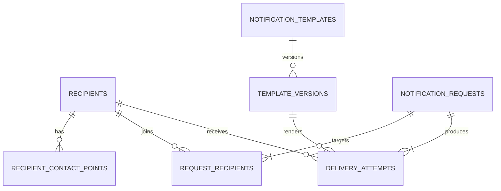

# Phase 4, Concept 1 — Database Schema

## Goal

Persist recipients, versioned templates, notification requests and individual delivery attempts while preserving constraints and historical truth.

## Relationship model



## Core schema

```sql
CREATE TABLE recipients (
    id UUID PRIMARY KEY,
    external_id VARCHAR(255) NOT NULL UNIQUE,
    created_at TIMESTAMPTZ NOT NULL DEFAULT CURRENT_TIMESTAMP
);

CREATE TABLE recipient_contact_points (
    id UUID PRIMARY KEY,
    recipient_id UUID NOT NULL REFERENCES recipients(id),
    channel VARCHAR(20) NOT NULL
        CHECK (channel IN ('email', 'sms', 'push')),
    destination VARCHAR(500) NOT NULL,
    is_active BOOLEAN NOT NULL DEFAULT TRUE,
    UNIQUE (recipient_id, channel, destination)
);
```

The recipient has stable identity even when an address changes. A separate contact table permits multiple device tokens and deactivation history.

## Versioned templates

```sql
CREATE TABLE notification_templates (
    id UUID PRIMARY KEY,
    template_key VARCHAR(255) NOT NULL UNIQUE
);

CREATE TABLE template_versions (
    id UUID PRIMARY KEY,
    template_id UUID NOT NULL REFERENCES notification_templates(id),
    channel VARCHAR(20) NOT NULL,
    version INTEGER NOT NULL CHECK (version > 0),
    subject VARCHAR(500),
    body TEXT NOT NULL,
    is_active BOOLEAN NOT NULL DEFAULT TRUE,
    UNIQUE (template_id, channel, version)
);
```

Create a new version instead of mutating content already referenced by historical attempts.

## Requests and recipients

```sql
CREATE TABLE notification_requests (
    id UUID PRIMARY KEY,
    template_key VARCHAR(255) NOT NULL,
    template_data JSONB NOT NULL,
    status VARCHAR(30) NOT NULL DEFAULT 'pending',
    created_at TIMESTAMPTZ NOT NULL DEFAULT CURRENT_TIMESTAMP,
    completed_at TIMESTAMPTZ,
    CHECK (status IN (
        'pending', 'processing', 'succeeded',
        'partially_succeeded', 'failed'
    ))
);

CREATE TABLE request_recipients (
    request_id UUID NOT NULL REFERENCES notification_requests(id),
    recipient_id UUID NOT NULL REFERENCES recipients(id),
    PRIMARY KEY (request_id, recipient_id)
);
```

The composite key prevents accidental duplicate recipients in one request. JSONB fits variable template data, while relationally important fields remain typed columns.

## Delivery attempts

```sql
CREATE TABLE delivery_attempts (
    id UUID PRIMARY KEY,
    request_id UUID NOT NULL REFERENCES notification_requests(id),
    recipient_id UUID NOT NULL REFERENCES recipients(id),
    template_version_id UUID NOT NULL REFERENCES template_versions(id),
    channel VARCHAR(20) NOT NULL,
    destination VARCHAR(500) NOT NULL,
    status VARCHAR(20) NOT NULL DEFAULT 'pending',
    provider_name VARCHAR(100),
    provider_message_id VARCHAR(255),
    error_code VARCHAR(100),
    error_message TEXT,
    created_at TIMESTAMPTZ NOT NULL DEFAULT CURRENT_TIMESTAMP,
    completed_at TIMESTAMPTZ,
    CHECK (channel IN ('email', 'sms', 'push')),
    CHECK (status IN ('pending', 'succeeded', 'failed'))
);
```

`destination` is a historical snapshot. Updating a recipient's current email must not rewrite where an earlier attempt was sent.

## Outcome constraint

```sql
ALTER TABLE delivery_attempts
ADD CONSTRAINT valid_delivery_outcome CHECK (
    (status = 'pending' AND completed_at IS NULL
        AND provider_message_id IS NULL AND error_code IS NULL)
 OR (status = 'succeeded' AND completed_at IS NOT NULL
        AND provider_message_id IS NOT NULL AND error_code IS NULL)
 OR (status = 'failed' AND completed_at IS NOT NULL
        AND error_code IS NOT NULL AND provider_message_id IS NULL)
);
```

Database constraints mirror important domain invariants and protect data written through any code path.

## Purposeful indexes

```sql
CREATE INDEX idx_contact_points_active
ON recipient_contact_points (recipient_id, channel)
WHERE is_active = TRUE;

CREATE INDEX idx_attempts_request
ON delivery_attempts (request_id);

CREATE INDEX idx_attempts_recipient_history
ON delivery_attempts (recipient_id, created_at DESC);

CREATE INDEX idx_attempts_pending
ON delivery_attempts (status, created_at);

CREATE UNIQUE INDEX idx_provider_message
ON delivery_attempts (provider_name, provider_message_id)
WHERE provider_message_id IS NOT NULL;
```

Each index supports a known query: active destination lookup, request results, recipient history, pending work, or provider-callback matching.

## Exercise answers

1. An address is not identity because it can change.
2. Attempts snapshot destinations for audit history.
3. Template versions preserve the exact content definition used.
4. `(request_id, recipient_id)` prevents duplicate audience rows.
5. Typed columns are preferable for frequent joins, constraints and indexes.

## Takeaway

> Persist the request, shared reference data and each physical delivery separately so constraints and history remain accurate.


