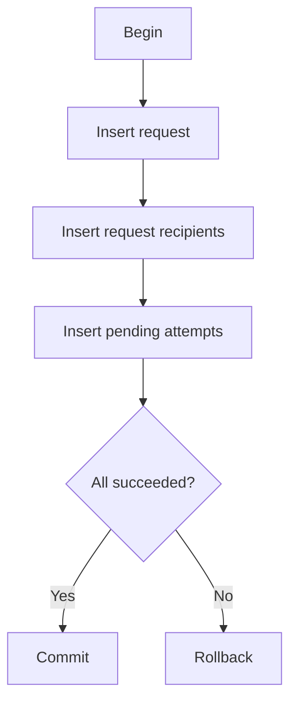
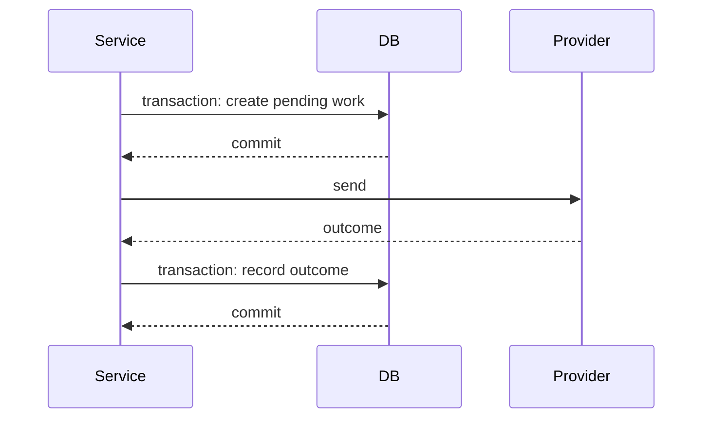

# Phase 4, Concept 3 — Transactions and Unit of Work

## Goal

Make related database changes atomic while keeping transaction boundaries explicit and short.

## Initial request transaction



An incomplete set of attempts must not remain when request creation fails halfway through.

## Unit of Work contract

```python
from typing import Protocol


class UnitOfWork(Protocol):
    requests: NotificationRequestRepository
    recipients: RecipientRepository
    templates: TemplateRepository
    deliveries: DeliveryAttemptRepository

    def __enter__(self) -> "UnitOfWork": ...
    def __exit__(self, exc_type, exc_value, traceback) -> None: ...
    def commit(self) -> None: ...
    def rollback(self) -> None: ...
```

All repositories in one Unit of Work share the same database connection and transaction.

## Explicit commit

```python
def create_notification(request, uow_factory) -> None:
    with uow_factory() as uow:
        uow.requests.add(request)

        for recipient_id in request.recipient_ids:
            uow.requests.add_recipient(
                request.request_id,
                recipient_id,
            )
            # Create and add the recipient-channel attempts.

        uow.commit()
```

Explicit commit is safer: exiting without it rolls back instead of accidentally persisting partial work.

## External calls are not transactional

Never hold a database transaction open while calling a provider. A database rollback cannot undo an accepted email or SMS.



There is unavoidable uncertainty if the provider accepts a message and the process crashes before recording success. Later idempotency and reconciliation address that gap.

## Related local updates

Updating a terminal attempt and recalculating its request status should share one transaction. Otherwise all attempts may be terminal while the request incorrectly remains pending.

## Concurrency

Two workers can finish attempts for the same request simultaneously. Protect aggregate status with targeted row locking or optimistic versioning:

```sql
UPDATE notification_requests
SET status = :status,
    row_version = row_version + 1
WHERE id = :request_id
  AND row_version = :expected_version;
```

Zero affected rows means another transaction changed the request; reload and retry.

## Exercise answers

1. Request and initial attempts share a transaction to avoid incomplete work.
2. Repositories share one connection so they participate in one transaction.
3. Network calls should occur outside long database transactions.
4. PostgreSQL rollback cannot undo an external provider side effect.
5. Optimistic versions detect lost-update races.

## Takeaway

> Transactions protect related local state; they cannot make third-party API calls atomic.


