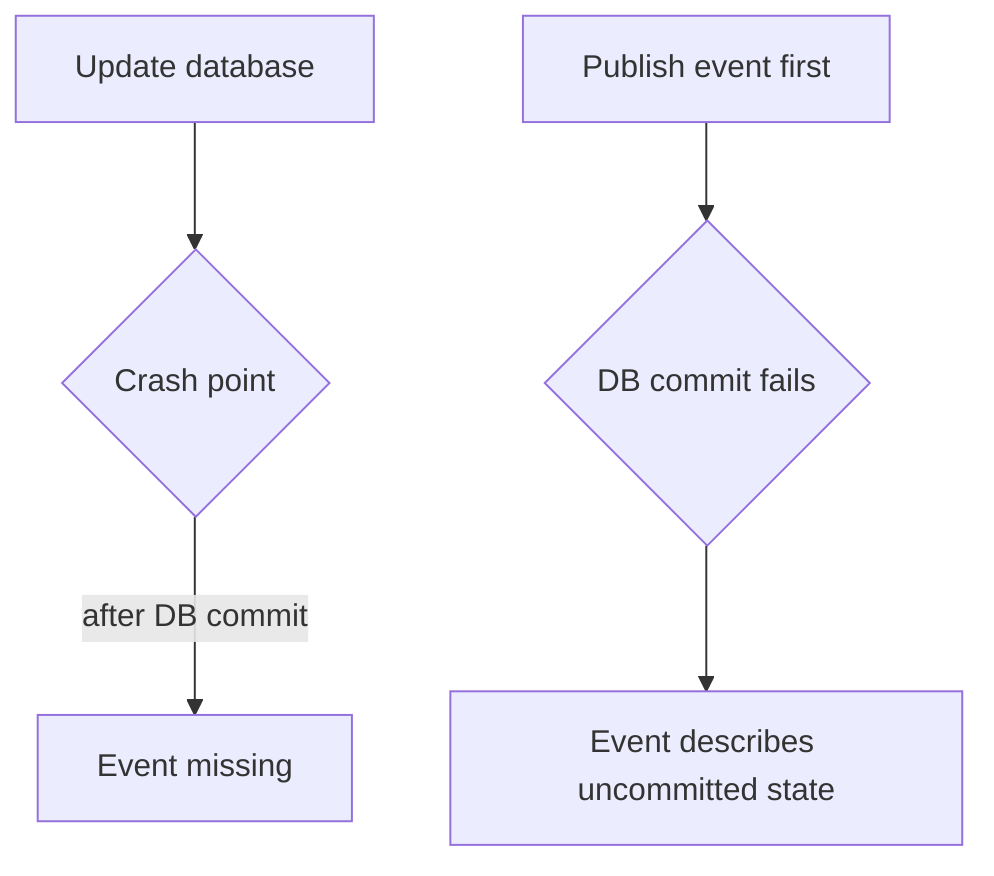

# Phase 4, Concept 4 — Transactional Outbox

## Goal

Reliably publish domain events after database changes without requiring an impossible transaction spanning both the database and a message broker.

## The dual-write problem

Consider:

```python
delivery_repository.update(attempt)
database.commit()
event_publisher.publish(DeliverySucceeded(...))
```

If the process crashes after commit but before publish, the database says the delivery succeeded while observers never receive the event.

Reversing the order is also unsafe:

```python
event_publisher.publish(event)
delivery_repository.update(attempt)
database.commit()
```

The event may be published even though the transaction later rolls back.



This is the dual-write problem.

## Outbox idea

Write the domain change and an event record to the same database transaction:

```text
One database transaction
├── update delivery_attempts
└── insert outbox_events
```

After commit, a separate relay publishes pending outbox rows to the broker.

## Outbox table

```sql
CREATE TABLE outbox_events (
    id UUID PRIMARY KEY,
    event_type VARCHAR(255) NOT NULL,
    aggregate_type VARCHAR(100) NOT NULL,
    aggregate_id UUID NOT NULL,
    payload JSONB NOT NULL,
    occurred_at TIMESTAMPTZ NOT NULL,
    published_at TIMESTAMPTZ,
    publish_attempts INTEGER NOT NULL DEFAULT 0,
    last_error TEXT
);

CREATE INDEX idx_outbox_unpublished
ON outbox_events (occurred_at)
WHERE published_at IS NULL;
```

The row itself is durable intent to publish.

## Domain event serialization

```python
import json
from dataclasses import asdict
from uuid import uuid4


@dataclass(frozen=True)
class OutboxEvent:
    event_id: UUID
    event_type: str
    aggregate_type: str
    aggregate_id: UUID
    payload: dict[str, object]
    occurred_at: datetime


def to_outbox_event(event: DeliverySucceeded) -> OutboxEvent:
    return OutboxEvent(
        event_id=uuid4(),
        event_type="delivery.succeeded.v1",
        aggregate_type="delivery_attempt",
        aggregate_id=event.attempt_id,
        payload={
            "attempt_id": str(event.attempt_id),
            "request_id": str(event.request_id),
            "recipient_id": event.recipient_id,
            "channel": event.channel.value,
            "provider_message_id": event.provider_message_id,
            "occurred_at": event.occurred_at.isoformat(),
        },
        occurred_at=event.occurred_at,
    )
```

Stable versioned event names allow payload evolution. Avoid serializing arbitrary object internals with `asdict()` as a public contract unless that coupling is intentional.

## Atomic application transaction

```python
def record_success(
    attempt_id: UUID,
    result: ProviderResult,
    uow_factory,
) -> None:
    with uow_factory() as uow:
        attempt = uow.deliveries.get(attempt_id)
        attempt.mark_succeeded(
            provider_name=result.provider_name,
            provider_message_id=result.provider_message_id,
            completed_at=clock.now(),
        )
        uow.deliveries.update(attempt)

        event = DeliverySucceeded(
            attempt_id=attempt.attempt_id,
            request_id=attempt.request_id,
            recipient_id=attempt.recipient_id,
            channel=attempt.channel,
            provider_message_id=result.provider_message_id,
            occurred_at=clock.now(),
        )
        uow.outbox.add(to_outbox_event(event))
        uow.commit()
```

The attempt update and outbox row now either both commit or both roll back.

## Relay worker

```python
class OutboxRelay:
    def __init__(self, uow_factory, broker) -> None:
        self._uow_factory = uow_factory
        self._broker = broker

    def publish_batch(self, batch_size: int = 100) -> int:
        with self._uow_factory() as uow:
            events = uow.outbox.claim_unpublished(batch_size)

            published = 0
            for event in events:
                try:
                    self._broker.publish(
                        topic=event.event_type,
                        message_id=str(event.event_id),
                        payload=event.payload,
                    )
                except Exception as error:
                    uow.outbox.record_failure(event.event_id, str(error))
                else:
                    uow.outbox.mark_published(
                        event.event_id,
                        clock.now(),
                    )
                    published += 1

            uow.commit()
            return published
```

The exact locking and transaction pattern depends on the broker and throughput requirements.

## Claiming work concurrently

PostgreSQL workers can claim different rows:

```sql
SELECT id, event_type, aggregate_id, payload, occurred_at
FROM outbox_events
WHERE published_at IS NULL
ORDER BY occurred_at
FOR UPDATE SKIP LOCKED
LIMIT :batch_size;
```

`SKIP LOCKED` lets several relays process independent batches without waiting on rows already claimed by another relay.

## At-least-once delivery

There is still a crash window:

1. relay publishes to broker;
2. relay crashes before setting `published_at`;
3. relay publishes the same event again later.

Therefore the practical guarantee is usually **at least once**, not exactly once.

Consumers must be idempotent. Use the stable `event_id` as the deduplication key:

```sql
CREATE TABLE processed_events (
    consumer_name VARCHAR(255) NOT NULL,
    event_id UUID NOT NULL,
    processed_at TIMESTAMPTZ NOT NULL,
    PRIMARY KEY (consumer_name, event_id)
);
```

If insertion conflicts, that consumer has already processed the event.

## Retention and monitoring

Operational requirements include:

- retrying transient publication failures;
- alerting on old unpublished rows;
- limiting or archiving published-event history;
- measuring relay delay and failure counts;
- protecting sensitive payload data;
- moving repeatedly failing events to investigation/dead-letter handling.

## Outbox versus delivery job queue

They are related but distinct:

- an outbox reliably publishes facts or commands created by a database transaction;
- a job queue schedules asynchronous work such as contacting a provider.

An outbox row can publish a `delivery.requested.v1` command to a queue, which a worker later processes.

## Exercise

1. What failure does the outbox prevent?
2. Why must the domain update and outbox insert share one transaction?
3. Can a relay guarantee no duplicate publications after crashes?
4. What key should consumers use for deduplication?
5. Why version an event type such as `delivery.succeeded.v1`?

## Answers

1. It prevents a committed local change from permanently losing its corresponding publication intent.
2. Atomicity guarantees either both records exist or neither does.
3. Usually no; at-least-once publication means consumers must tolerate duplicates.
4. The stable outbox/event ID, scoped to the consumer.
5. Versioning allows event contracts to evolve deliberately.

## Phase 4 completion checklist

- [x] Relational schema and constraints documented.
- [x] Template versioning and destination snapshots preserved.
- [x] Repository contracts and mappings defined.
- [x] Transaction boundaries and Unit of Work explained.
- [x] External-call transaction limitations identified.
- [x] Concurrency controls introduced.
- [x] Transactional outbox and relay documented.
- [x] At-least-once delivery and consumer idempotency explained.

## Phase 4 takeaway

> Commit durable business state and publication intent together; publish asynchronously and design consumers for duplicates.

