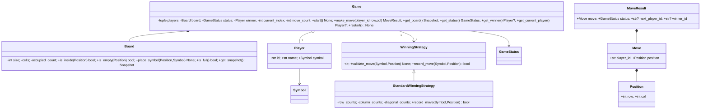

# Phase 05 — Tic-Tac-Toe Class Design

Design-only contracts, types, exceptions, UML, invariants and reasoning. No complete engine implementation yet.

---

## Goal and scope

Two unique Players, N x N Board, explicit start, alternate moves, traditional row/column/diagonal win, full-board draw, restart, optional custom winning-rule factory. Initial version uses Symbol X/O and GameStatus NOT_STARTED/IN_PROGRESS/WON/DRAW.

---

## UML class diagram (Mermaid)



---

## Value types and equality

```python
from enum import Enum
from dataclasses import dataclass
class Symbol(Enum):
    X = 'X'
    O = 'O'
class GameStatus(Enum):
    NOT_STARTED = 'NOT_STARTED'
    IN_PROGRESS = 'IN_PROGRESS'
    WON = 'WON'
    DRAW = 'DRAW'
@dataclass(frozen=True)
class Position:
    row: int
    col: int
@dataclass(frozen=True)
class Move:
    player_id: str
    position: Position
@dataclass(frozen=True, eq=False)
class Player:
    id: str
    name: str
    symbol: Symbol
    def __eq__(self, other):
        return self.id == other.id if isinstance(other, Player) else NotImplemented
    def __hash__(self):
        return hash(self.id)
@dataclass(frozen=True)
class MoveResult:
    move: Move
    status: GameStatus
    next_player_id: str | None
    winner_id: str | None
```
Entity Player equality uses stable ID, whereas Position/Move use value equality. Because Player is frozen and its ID must never change, hashing by ID is safe. Validate individual Player fields in construction and uniqueness across participants in Game.

---

## Board interface

```python
class Board:
    def __init__(self, size: int = 3) -> None: ...
    @property
    def size(self) -> int: ...
    @property
    def occupied_count(self) -> int: ...
    def is_inside(self, position: Position) -> bool: ...
    def is_empty(self, position: Position) -> bool: ...
    def place_symbol(self, position: Position, symbol: Symbol) -> None: ...
    def is_full(self) -> bool: ...
    def get_snapshot(self) -> tuple[tuple[Symbol | None, ...], ...]: ...
```
Board constructor validates positive integer N (explicitly reject bool). Internal _cells is a private list of lists, _occupied_count tracks occupancy. is_inside returns False for integer coordinates outside range; is_empty rejects invalid positions. place_symbol validates coordinates and vacant cell, mutates exactly one cell, increments count; returns None or raises. Snapshot is deeply immutable tuple of tuples; do not leak _cells. Board does not know current player or game status.

---

## Game interface

```python
class Game:
    def __init__(self, players: tuple[Player, Player] | list[Player], board_size: int = 3,
                 starting_player_id: str | None = None,
                 winning_strategy_factory: WinningStrategyFactory | None = None) -> None: ...
    def start(self) -> None: ...
    def make_move(self, player_id: str, row: int, col: int) -> MoveResult: ...
    def get_board(self) -> tuple[tuple[Symbol | None, ...], ...]: ...
    def get_current_player(self) -> Player | None: ...
    def get_status(self) -> GameStatus: ...
    def get_winner(self) -> Player | None: ...
    def restart(self) -> None: ...
```
Constructor validates exactly two Player objects, unique IDs and symbols, names, board size, and starter membership. Defaults to first supplied player; starts NOT_STARTED with no current player and no winner. start() transitions only NOT_STARTED -> IN_PROGRESS and rejects repetition. make_move() validates state, player identity, turn, coordinates and vacancy; commits move, consults winning rule, sets WON first, DRAW next, otherwise advances turn; returns MoveResult for accepted moves only. get_current_player returns None before start and after game ends. restart() creates a fresh board and winning-rule state, clears winner and move count, restores original starter, sets IN_PROGRESS. Avoid multiple mutable Game instances sharing a board or strategy.

---

## WinningStrategy abstraction

```python
from abc import ABC, abstractmethod
from collections.abc import Callable
class WinningStrategy(ABC):
    @abstractmethod
    def validate_move(self, symbol: Symbol, position: Position) -> None: ...
    @abstractmethod
    def record_move(self, symbol: Symbol, position: Position) -> bool: ...
WinningStrategyFactory = Callable[[int], WinningStrategy]
class StandardWinningStrategy(WinningStrategy):
    def __init__(self, board_size: int) -> None: ...
    def validate_move(self, symbol: Symbol, position: Position) -> None: ...
    def record_move(self, symbol: Symbol, position: Position) -> bool: ...
```
validate_move is a side-effect-free hook executed before board placement; standard version does nothing for otherwise valid moves. record_move is called only for accepted moves and returns whether the current move wins. Game controls winner/status; strategy never mutates Board. Factory constructs a fresh stateful strategy per round and can default to StandardWinningStrategy. Standard strategy stores separate row/column and both diagonal counts by symbol. Two players => O(N) auxiliary counters and amortized O(1) detection per accepted move. Future K-consecutive rules may have different costs. Need clear exception/rollback contract for buggy custom strategies that raise after board mutation.

---

## Domain exceptions

```python
class TicTacToeError(Exception): pass
class InvalidConfigurationError(TicTacToeError): pass
class InvalidGameStateError(TicTacToeError): pass
class UnknownPlayerError(TicTacToeError): pass
class NotYourTurnError(TicTacToeError): pass
class InvalidPositionError(TicTacToeError): pass
class CellOccupiedError(TicTacToeError): pass
```
Invalid board size, invalid participant config or invalid starter -> InvalidConfigurationError. Before start, after game end, or repeated start -> InvalidGameStateError. Unregistered player -> UnknownPlayerError. Wrong turn -> NotYourTurnError. Bad row/column -> InvalidPositionError. Occupied destination -> CellOccupiedError. Raise rather than returning False for invalid moves. Validation failures must not mutate anything.

---

## Move order and invariants

1. Validate IN_PROGRESS, known player, correct turn.
2. Construct Position and validate Board coordinates/occupancy plus any custom strategy preconditions.
3. Board places symbol and increments occupied count.
4. WinningStrategy records accepted move, computes win.
5. If win, set GameStatus.WON and winner; next player None.
6. Else if Board.is_full(), set DRAW; next player None.
7. Else advance turn, keep IN_PROGRESS; next player new ID.
8. Return immutable MoveResult.

Invariants: Board always N x N; occupied_count matches nonempty cells; winning counters represent accepted moves only; exactly two unique players; status WON iff winner present; next active player exists only IN_PROGRESS; restart clears all session state. Last move creating a winning line is WON even if board full. Public get_board returns immutable snapshot.

---

## Public/private, SRP and tradeoffs

Public: make_move, start, restart, get_board/status/winner/current_player; board placement/snapshot helpers. Internal: Game._board/_status/_current_player_index/_winner/_move_count; Board._cells/_occupied_count; Strategy._row_counts and related counters. Underscore is Python convention, not hard privacy enforcement.
Frozen Player/Move/Position improve predictable state; Cell omitted because grid values suffice; GameManager omitted for a single session; TurnManager omitted because alternating turns are simple; State pattern omitted because enum state transitions are straightforward. WinningStrategy is justified by custom rules; simple callable factory avoids heavy factory framework. CLI/DRF/UI performs presentation, not Board.
Failure atomicity: a custom stateful winning strategy unexpectedly raising after board mutation can leave inconsistent state. Before implementation either guarantee trusted strategy updates do not fail for accepted inputs, or design explicit recovery/transaction boundaries. In-memory method calls do not imply concurrency safety.

---

## Usage sketch

```python
alice = Player('P101', 'Alice', Symbol.X)
bob = Player('P102', 'Bob', Symbol.O)
game = Game([alice, bob], board_size=3, starting_player_id='P101')
game.start()
result = game.make_move('P101', 0, 0)
assert result.status == GameStatus.IN_PROGRESS
assert result.next_player_id == 'P102'
# Repeating P101 raises NotYourTurnError, with no state change.
```
This is a contract example; complete executable implementation follows in Phase 8.

---

## Interview rehearsal

Explain why Board owns bounds and grid mutation while Game owns turns/state; why win checking belongs to replaceable strategy; when method returns None vs MoveResult vs raises; why snapshots prevent leaks; how strategy counters reset on restart; how to distinguish win from draw on final move; and why raw exception classes support API adapters.

---

## Next phase

Phase 06 — Game Lifecycle and State Transitions. Then Phase 07 winning algorithms, Phase 08 complete machine coding, Phase 09 testing, and extensions.