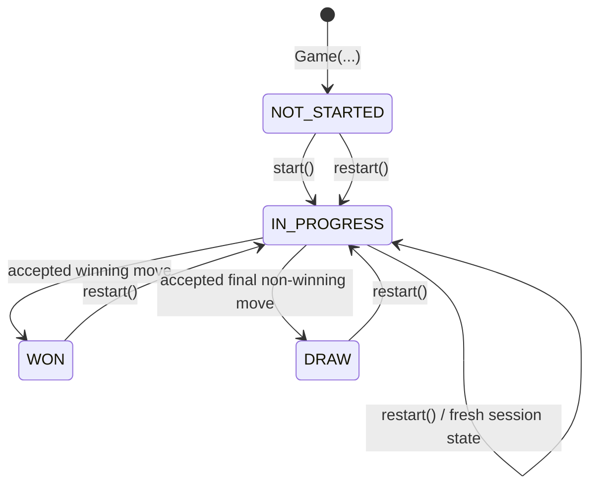

# Phase 06 — Game Lifecycle and State Transitions

## Purpose
Understand NOT_STARTED, IN_PROGRESS, WON, DRAW, permitted transitions, ordering of move checks, error handling, session invariants, and restart. This phase illustrates flow without completing the machine-coding engine (Phase 8).

## States
- NOT_STARTED: Game constructed, empty board, no accepted moves; explicit start() not yet called.
- IN_PROGRESS: accepts moves from current player.
- WON: terminal with registered winner.
- DRAW: terminal with full board and no winner.

## State diagram


## Transition table
| Current | Action | Outcome |
|---|---|---|
| NOT_STARTED | start | IN_PROGRESS, configured starter |
| NOT_STARTED | make_move | InvalidGameStateError, no change |
| NOT_STARTED | restart | Fresh IN_PROGRESS |
| IN_PROGRESS | accepted ordinary move | IN_PROGRESS, next player's turn |
| IN_PROGRESS | accepted winning move | WON, winner recorded, no next active player |
| IN_PROGRESS | accepted last non-winning move | DRAW, no winner or active player |
| IN_PROGRESS | invalid move | exception, no change |
| IN_PROGRESS | start | InvalidGameStateError |
| IN_PROGRESS | restart | Fresh IN_PROGRESS |
| WON or DRAW | make_move / start | InvalidGameStateError |
| WON or DRAW | restart | Fresh IN_PROGRESS |

## Full state vs status
GameStatus is only a label. Complete mutable state includes board cells/occupied count, current player index, winner, move count and winning strategy counters. Transitions must keep these synchronized.

## Successful move flow
1. Game verifies status IN_PROGRESS; otherwise InvalidGameStateError.
2. Game verifies player ID exists; otherwise UnknownPlayerError.
3. Game verifies requested player is the current player; otherwise NotYourTurnError.
4. Build Position(row,col); Board validates coordinates and vacancy; optional winning-rule validate_move is side-effect-free.
5. Board.place_symbol writes one symbol and increments occupied count.
6. WinningStrategy.record_move updates accepted-move counters; returns whether player wins.
7. If win: Game sets status WON, winner player; next_player_id None.
8. Else if board full: Game sets DRAW, winner None; next_player_id None.
9. Else: Game advances turn and stays IN_PROGRESS.
10. Return immutable MoveResult for the accepted move.

## Why ordering matters
Bad order: changing turn before board validation causes an invalid occupied-cell attempt to steal a turn.
Correct: validate before mutation; update strategy only for accepted moves; move turn only on valid non-terminal result.
Check win BEFORE draw: the final filled cell can complete a line, in which case outcome is WON.

## Conceptual Python
```python
def make_move(self, player_id: str, row: int, col: int) -> MoveResult:
    self._ensure_in_progress()
    player = self._validate_turn(player_id)
    position = Position(row, col)
    # Board and rule validation happen before mutations.
    self._winning_strategy.validate_move(player.symbol, position)
    self._board.place_symbol(position, player.symbol)
    did_win = self._winning_strategy.record_move(player.symbol, position)
    self._move_count += 1
    if did_win:
        self._winner = player
        self._status = GameStatus.WON
    elif self._board.is_full():
        self._status = GameStatus.DRAW
    else:
        self._current_player_index = 1 - self._current_player_index
    # Construct MoveResult, next_player_id only if status IN_PROGRESS.
```
This is flow pseudocode using Python syntax; it deliberately omits return and error-atomicity implementation. Board validates occupied/out-of-range cells before mutating.

## Invariants
- Exactly two unique player IDs and symbols.
- Board contains N x N cells.
- board.occupied_count == move_count == number of accepted moves.
- Winning counts reflect accepted moves of the active round only.
- status == WON if and only if winner is not None.
- status == DRAW means board full and winner None.
- NOT_STARTED means empty board, no active player.
- Only IN_PROGRESS exposes an active next player.
- Terminal statuses reject further moves.
- Invalid move leaves board, counters, turn, status, winner, and move count unchanged.

## Turn logic
For exactly two players, switch index using 1 - current_index. Only switch on accepted, non-terminal moves. For general m participants a future policy could use (index + 1) % m; not needed now.

## Restart
Restart creates fresh Board, fresh strategy state, no winner, zero move count, configured starting player, and IN_PROGRESS status. Players and board dimension persist.
```python
def restart(self) -> None:
    new_board = Board(self._board_size)
    new_rule = self._strategy_factory(self._board_size)
    # Only publish new objects after successful construction.
    self._board = new_board
    self._winning_strategy = new_rule
    self._winner = None
    self._move_count = 0
    self._current_player_index = self._starting_index
    self._status = GameStatus.IN_PROGRESS
```
Constructing replacement components before swapping avoids partial reset on a constructor failure. This is not a substitute for concurrency control.

## Domain errors
- InvalidGameStateError: attempt before start, after terminal, or duplicate start.
- UnknownPlayerError: player not part of game.
- NotYourTurnError: other registered player attempted move.
- InvalidPositionError: out-of-bounds row/column.
- CellOccupiedError: destination already occupied.
- InvalidConfigurationError: invalid constructor inputs.

## Failure atomicity limitations
Typical invalid inputs are rejected before mutation. But a malicious/buggy custom strategy that raises after Board placement could leave Board and counters inconsistent. An implementation must either enforce a trusted non-throwing strategy contract for valid accepted moves or add rollback/recovery. These in-memory methods also do not solve concurrency between multiple threads/processes; online moves require locking and/or storage transactions.

## Why we skip State pattern for now
The four lifecycle values have small, predictable transitions, so an enum plus Game methods is clearer than State classes. Reconsider a State pattern only if behaviors diverge substantially.

## Test scenarios
1. Constructor has NOT_STARTED, empty board, no winner/current player.
2. start() selects configured first player; duplicate start rejected.
3. Wrong turn, occupied cell, out-of-bounds and unknown ID raise without effects.
4. Accepted ordinary move advances turn exactly once.
5. Row, column and diagonal victories set WON and winner.
6. Full non-winning board sets DRAW.
7. Final-cell win is WON, not DRAW.
8. After terminal state no moves accepted.
9. Restart from NOT_STARTED, IN_PROGRESS, WON, DRAW makes fresh IN_PROGRESS state.
10. Restart never carries old counter values; independent games remain independent.

## Interview answers
- Game owns lifecycle; Board owns cell integrity; WinningStrategy owns win algorithm.
- Status is not the whole state.
- Win before draw and never switch turns on invalid/terminal moves.
- Restart resets both Board and winning-rule counters.
- Enum transitions are sufficient; do not add State pattern for ceremony.

## Next
Phase 07: Naive vs O(1) winner detection, counters, tricky diagonals, complexities and correctness.